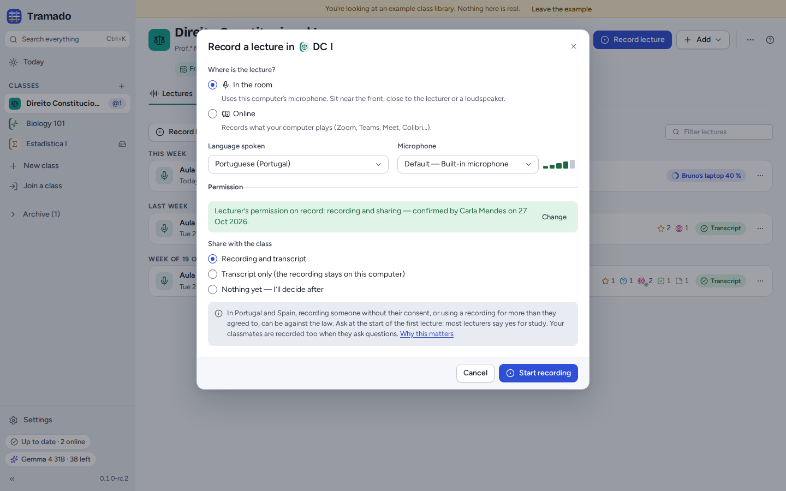

<p align="center"></p>

<h1 align="center">Tramado</h1>

<p align="center"><b>Your classes, all in one place.</b><br>
Record and transcribe lectures, keep every handout and law text together, share them with your class without a
server, and practise for exams with an AI that shows where each answer comes from.</p>

<p align="center"><a href="docs/manual/en/index.md">Manual</a> ·
<a href="docs/manual/pt/index.md">Manual (Português)</a> ·
<a href="docs/manual/es/index.md">Manual (Español)</a> ·
<a href="PRIVACY.md">Privacy</a> ·
<a href="docs/release-notes/v0.1.0.md">Release notes</a></p>

> **Release candidate 0.1.0-rc.1.** Tested on Linux (Ubuntu 24.04, WebKitGTK). Windows and macOS installers are built
> by CI but nobody has tested them yet. Tramado is new: keep copies of anything you cannot afford to lose.


Tramado is a free, open-source desktop app for university students. Each class is an ordinary folder on your computer
with its lectures, documents, notes and exams. Share a class and your classmates get the same folder, synchronised
directly between your computers. There is no Tramado server and no account to create.

## What it does

### Lectures, recorded and transcribed on your computer

Record a lecture in the room (the microphone) or online (what your computer plays: Zoom, Teams, Meet…), or add a
recording you already have. Tramado asks you to confirm the lecturer's permission first. Transcription runs **on your
computer** with [whisper.cpp](https://github.com/ggml-org/whisper.cpp): the speech model (574 MB recommended, 190 MB
or 1.08 GB as alternatives) downloads once, the first time you need it, and then works offline. In a shared class
exactly one computer transcribes each lecture and everyone gets the transcript; classmates whose computers are plugged
in can volunteer. Follow along as it plays, mark moments with <kbd>1</kbd>–<kbd>4</kbd>, take notes at a timestamp,
correct the transcript together, and export it as Markdown, subtitles or plain text.


### Documents you can search

Drop slides, readings and legislation into a class: PDF, Word, PowerPoint, OpenDocument, RTF, HTML, text, subtitles
and images. Tramado reads their text so that <kbd>Ctrl</kbd>+<kbd>K</kbd> finds a phrase across lectures, documents,
exams and chat at once, and opens the PDF on the right page with the passage marked. Notes are Markdown: class notes
are shared, your own stay on your computer.

### Exams, practised with an AI that cites your sources

Add the date of your next test for a countdown, or add a past exam paper (PDF, Word, a photo, or typed). The AI finds
the questions; you check them; then it drafts answers **from your own class material**, citing the page, the article
of law or the minute of the lecture each claim comes from, with a "grounded" score. Practise question by question, and
the ones you missed come back.


### Class groups, without a server

Invite classmates with one message (a link, a code, a QR code or a file). They get the lectures, transcripts,
documents, class notes and a class chat with mentions, replies and an `@AI` that answers from the class's sources.
Sharing runs on [Syncthing](https://syncthing.net), bundled with Tramado: files travel encrypted, directly between your
computers. Organisers can ask to approve each newcomer, and everyone can compare **check words** to be sure who they let
in. Your own notes, highlights, practice and Ask conversations stay on your computer.


## Privacy

- **No server, no account, no telemetry, no analytics, no crash reports.** Tramado makes no connection of its own
  until you share a class, turn on AI or download a speech model.
- **What leaves your computer, and when, is listed in full in [PRIVACY.md](PRIVACY.md)**
  ([Português](PRIVACY.pt.md) · [Español](PRIVACY.es.md)). The same table is in the app, in Settings › Privacy. It is
  generated from the code (`app/src/core/privacy/flows.ts`), so the two cannot drift apart.
- The app's window has no network access at all: connections are made only by the app's own process (to OpenRouter,
  Hugging Face and AI services you approved) and by its Syncthing, and your OpenRouter key never reaches the window.
- Settings › Privacy keeps a private list of every AI request made from your computer. It is never sent anywhere.

## AI: free by default, with your own key

AI is optional; everything else works without it. Tramado uses [OpenRouter](https://openrouter.ai) with **your own key**
(free keys work) and asks by default for the free model **`google/gemma-4-31b-it:free`**, falling back to other free
models when it is busy. You choose what providers may do with what you send: *Keep nothing*, *No training*
(recommended, the default) or *Allow free models that may train*, and Tramado never relaxes that choice without asking
you in a window of its own. Cloud transcription through OpenRouter is optional and paid (about 2 cents per lecture);
local transcription is free.

> **OpenRouter is for people aged 18 or over** (its terms of service). If you are younger, skip AI, or connect an
> **OpenAI-compatible service** you run yourself or your school provides instead: a local
> [Ollama](https://ollama.com) or [LM Studio](https://lmstudio.ai), or a school server (Settings › AI › *Another
> OpenAI-compatible service*). Plain `http` is allowed only for your own computer and your local network.

## Install

**Linux** (x86-64): download the `.AppImage` (any distribution: make it executable and open it) or the `.deb` (Debian,
Ubuntu) from the [Releases page](https://github.com/feiteira/Tramado/releases) once 0.1.0 is published; until then,
build from source (below). The installers contain the app, Syncthing and the voice-activity model; the speech model
downloads when you first transcribe.

**Windows 10/11 and macOS 14.2+**: CI builds an NSIS installer and a universal `.dmg`, unsigned (macOS: signed ad hoc),
and **untested**. If you try them, please [report what happens](https://github.com/feiteira/Tramado/issues).

Local transcription needs a 64-bit processor with AVX2 (Intel and AMD since about 2013) or Apple silicon; without it,
classmates' computers or OpenRouter can transcribe for you.

### Build from source

Requirements: Node.js 22.12 or later, Rust stable 1.90 or later (`rust-toolchain.toml` picks it), and on Linux:

```bash
sudo apt install libwebkit2gtk-4.1-dev libgtk-3-dev libsoup-3.0-dev librsvg2-dev libayatana-appindicator3-dev \
  patchelf libasound2-dev libpulse-dev libclang-dev cmake
```

```bash
git clone https://github.com/feiteira/Tramado.git && cd Tramado
npm install
npm run dev:web          # the browser demo, with fictional classes, at http://localhost:1420
npm run dev              # the desktop app (fetches Syncthing and the voice-activity model, both checked by SHA-256)
npm run build:desktop    # AppImage and .deb in target/release/bundle/
```

Contributors: start with [CONTRIBUTING.md](CONTRIBUTING.md) and [AGENTS.md](AGENTS.md) (commands, layout, rules).
Security issues: [SECURITY.md](SECURITY.md).

## More pictures

| | |
|---|---|
|  |  |
|  |  |

The pictures come from the browser demo: the classes, people and documents in them are fictional.

## Languages

English, European Portuguese and European Spanish: the app, the manual, the privacy page and the release notes.

## Documentation

- The manual: [English](docs/manual/en/index.md) · [Português](docs/manual/pt/index.md) · [Español](docs/manual/es/index.md)
- [Release notes 0.1.0](docs/release-notes/v0.1.0.md)
- For developers: [architecture](docs/dev/architecture.md), the [class folder format](docs/spec/class-folder-v1.md), the
  [sync protocol](docs/spec/sync-protocol-v1.md), the [UX specification](docs/design/ux-mvp.md)

## Credits

Tramado is built on [Trama](https://github.com/feiteira/Trama) (its interface kit, shell, import and search code,
desktop crates and tools) and on the work of many open-source projects, among them
[Syncthing](https://syncthing.net) (sharing), [whisper.cpp](https://github.com/ggml-org/whisper.cpp) and OpenAI's
Whisper models (transcription), [Silero VAD](https://github.com/snakers4/silero-vad) (finding speech),
[libopus](https://opus-codec.org) (recordings), [pdf.js](https://mozilla.github.io/pdf.js/) (PDFs),
[mammoth](https://github.com/mwilliamson/mammoth.js) (Word files), [Tauri](https://tauri.app) and
[React](https://react.dev) (the app), [Lucide](https://lucide.dev) (icons) and the Figtree, Bricolage Grotesque,
Source Serif 4, Atkinson Hyperlegible Next and OpenDyslexic fonts. See [NOTICE](NOTICE) and Settings › About ›
Licences.

## License

[Mozilla Public License 2.0](LICENSE). © Tramado contributors.
