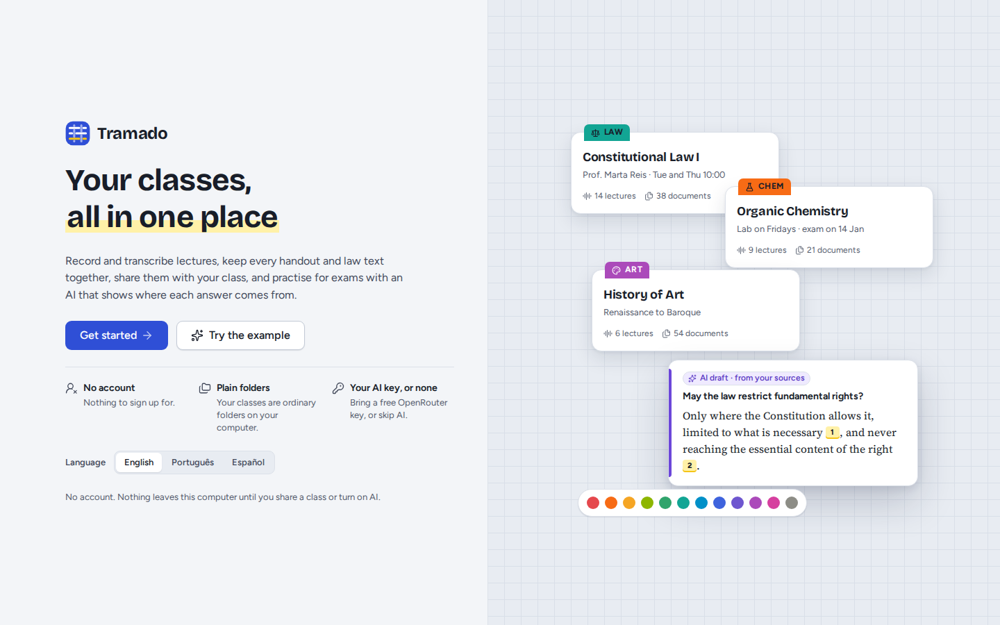
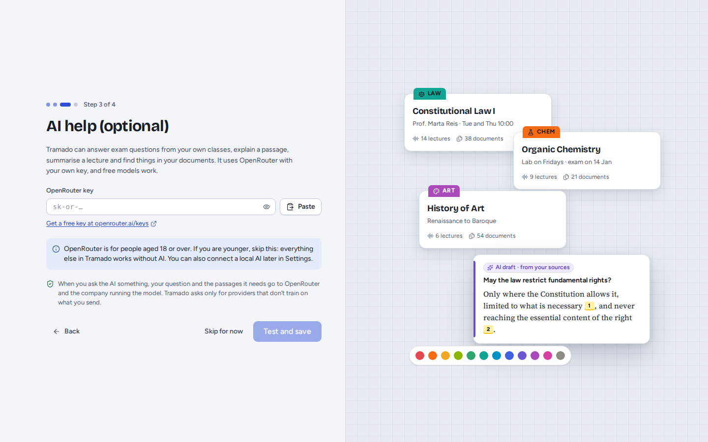
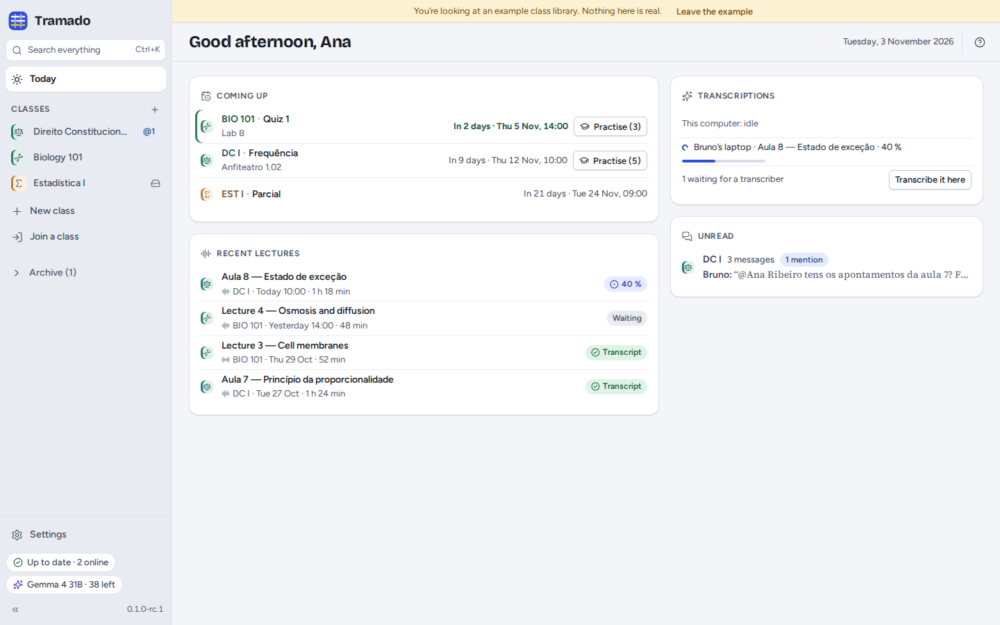

# 1. Getting started

[Contents](index.md) · Next: [Classes](02-classes.md)

## Installing

- **Linux**: the `.AppImage` works on most distributions (make it executable, then open it); the `.deb` is for Debian
  and Ubuntu. Both contain Tramado, the Syncthing program that shares classes, and the small model that finds speech
  in recordings.
- **Windows and macOS**: installers are built automatically but have not been tested yet. They are not code-signed:
  Windows SmartScreen asks you to confirm (*More info › Run anyway*); on macOS open the app once, then *System Settings ›
  Privacy & Security › Open Anyway*.

The speech model that transcribes lectures is not in the installer: Tramado downloads it the first time you transcribe
(see [Lectures](03-lectures.md#transcription)).

## The first start

Choose your language at the bottom, then **Get started**. (**Try the example** opens a fictional class library
instead: see [below](#the-example-library).) Three short steps follow:

1. **Your name**, as classmates will see it next to your messages and recordings, and the name of this computer. The
   line underneath says where your classes are kept (a folder called `Tramado` in your home folder); **Change…** picks
   another place. Avoid a folder that Dropbox, OneDrive or Google Drive already synchronises: Tramado warns you if you
   pick one.
2. **AI help (optional).** Paste an OpenRouter key and press **Test and save**, or **Skip for now**. Everything except
   the AI features works without it. OpenRouter is for people aged 18 or over; if you are younger, skip this step (you
   can connect a local AI service later). See [AI](07-ai.md).
3. **You're set**: create your first class, or join one with an invite a classmate sent you.

## The Today screen

**Today** collects what needs you now:

- **Coming up**: tests and exams of the next weeks, with a countdown and **Practise** for classes with questions to
  practise.
- **Transcriptions**: what this computer and your classmates' computers are transcribing, and lectures waiting for a
  transcriber (**Transcribe it here**).
- **Recent lectures** and **Unread** messages and mentions in your classes' chats.

On the left, the **rail**: **Search everything** (<kbd>Ctrl</kbd>+<kbd>K</kbd>), **Today**, your **classes**
(<kbd>Ctrl</kbd>+<kbd>1</kbd>…<kbd>9</kbd> opens them), **New class**, **Join a class**, the **Archive** and
**Settings**. At the bottom, two status pills:

- the **sharing pill** (for example *Up to date · 2 online*, *Syncing 3 files*, *Waiting for classmates*): click it for
  details and problems;
- the **AI pill**, with your model and the free requests left today.

## The example library

**Try the example** on the welcome screen opens a library of fictional classes (Constitutional Law in Portuguese,
Biology in English, Statistics in Spanish) with lectures, documents, exams and a class chat, so you can try
everything without recording or sharing anything. A yellow ribbon reminds you it is not real; **Leave the example**
returns to your own library (the welcome screen, if you have not set Tramado up yet). Nothing you do in the example is
kept.

## Help

<kbd>F1</kbd> or <kbd>?</kbd> lists the keyboard shortcuts; among them <kbd>Ctrl</kbd>+<kbd>Shift</kbd>+<kbd>R</kbd>
starts or stops a recording and <kbd>Ctrl</kbd>+<kbd>,</kbd> opens Settings (<kbd>⌘</kbd> instead of <kbd>Ctrl</kbd> on a
Mac). Settings › About has **Copy diagnostics** (a summary for a
bug report, with no content of your classes; nothing is sent) and **Test audio playback**.
