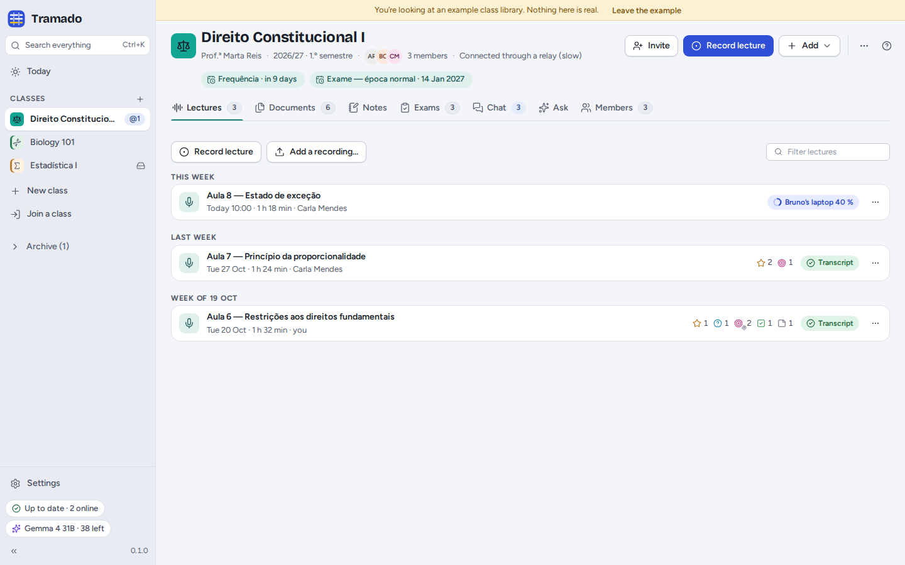
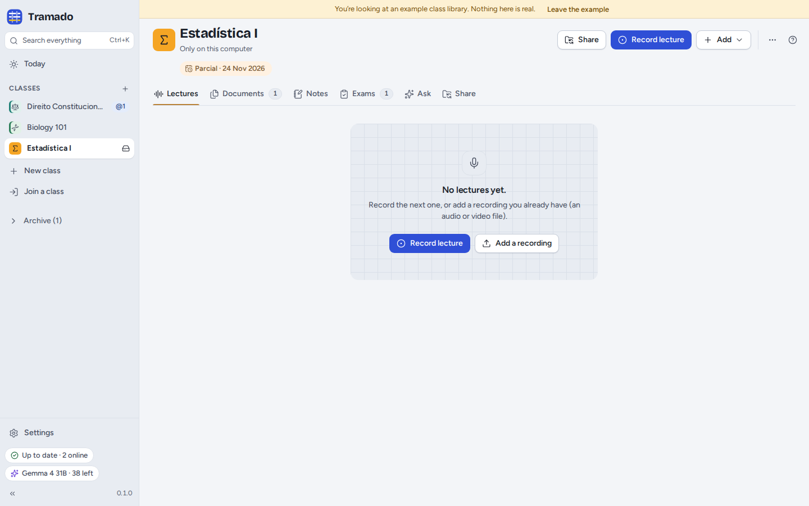

# 2. Classes

[Contents](index.md) · Previous: [Getting started](01-getting-started.md) · Next: [Lectures](03-lectures.md)

A **class** is one subject you are taking. Everything for it lives in one ordinary folder on your computer, which you
can open, back up or copy like any other folder.

## Creating a class

**New class** in the rail (or <kbd>+</kbd> next to *Classes*) opens a short form:

- **Name** (for example *Teoria Geral do Direito Civil*) and a **Short name** for chat, notifications and tight
  spaces;
- **Colour** and **Icon**, so the class is easy to spot everywhere;
- **Lecturer** and **Term** (optional);
- **Language spoken in lectures**, used for transcripts and AI answers (or *Detect automatically*);
- **Share with classmates**: on, classmates you invite get the lectures, documents, class notes and chat; off, the
  class stays only on this computer, and you can share it later (see [Class groups](06-class-groups.md));
- **Vocabulary for transcripts**: names and terms the lecturer uses (for example *Gomes Canotilho, quid iuris*), so
  the speech model spells them right.

## The class screen

The header shows the class's name, lecturer and term, its members, the next exam dates and how it is syncing. Its
buttons:

- **Invite** (shared classes) or **Share** (classes only on this computer);
- **Record lecture**;
- **Add**: documents, a recording, an exam date, an exam paper, a note or a class note;
- **⋯**: **Class settings…** (the same form as above, plus *Ask before letting people in* and *Skip audio files on this
  computer* for shared classes), **Notifications**, **Recently deleted…**, **Open folder**, **Archive**, **Leave
  class…** and **Delete class…**.

The tabs: **Lectures**, **Documents**, **Notes**, **Exams**, **Chat**, **Ask** and **Members** (a class only on this
computer has **Share** instead of Chat and Members).

## The class folder

A class folder holds `Lectures`, `Documents`, `Exams` and `Notes` (named in the language of whoever created the class:
`Aulas`, `Documentos`, `Exames`, `Apontamentos` in Portuguese; `Clases`, `Documentos`, `Exámenes`, `Apuntes` in Spanish), plus
a hidden `.tramado` folder with the class's own records (members, chat, transcription claims, corrections…). Each
lecture is a folder with its recording (`audio.webm`) and its transcript (`transcript.md`, `transcript.vtt`). You can
rename these folders in your file manager; Tramado finds its files by what they contain, not by their names. Leave
`.tramado` alone.

Your private things are **not** in the class folder: your own notes and highlights, your practice, your AI
conversations and the AI activity log stay in Tramado's own data on this computer. They reach classmates only if you
move a note to the class notes or post an answer to the chat yourself.

## Recently deleted

In a shared class, files deleted by you or by a classmate can be restored for everyone for 30 days from **⋯ › Recently
deleted…**. If many files disappear from a shared class's folder at once outside Tramado (more than 20 in 10 seconds),
sharing for that class pauses and Tramado asks whether you meant it before your classmates' copies are touched.

## Archive, leave, delete

- **Archive** moves a class you no longer follow to the rail's **Archive**, still complete; **Unarchive** brings it
  back.
- **Leave class…** (shared classes) stops updates. Your copy stays on this computer unless you also tick *Also delete
  my copy from this computer*. What you added stays with your classmates: remove it before leaving if you want it gone.
- **Delete class…** deletes the folder and everything in it from this computer, after you type the class's name. This
  cannot be undone.
