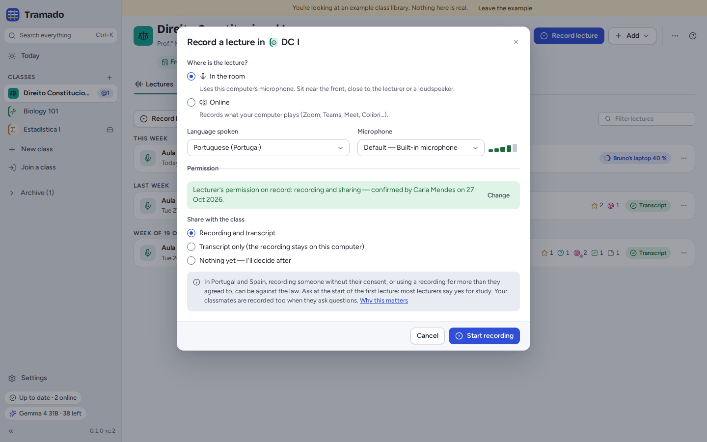
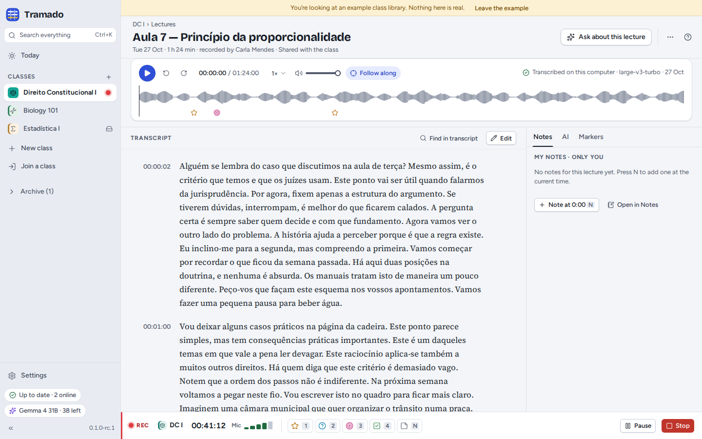
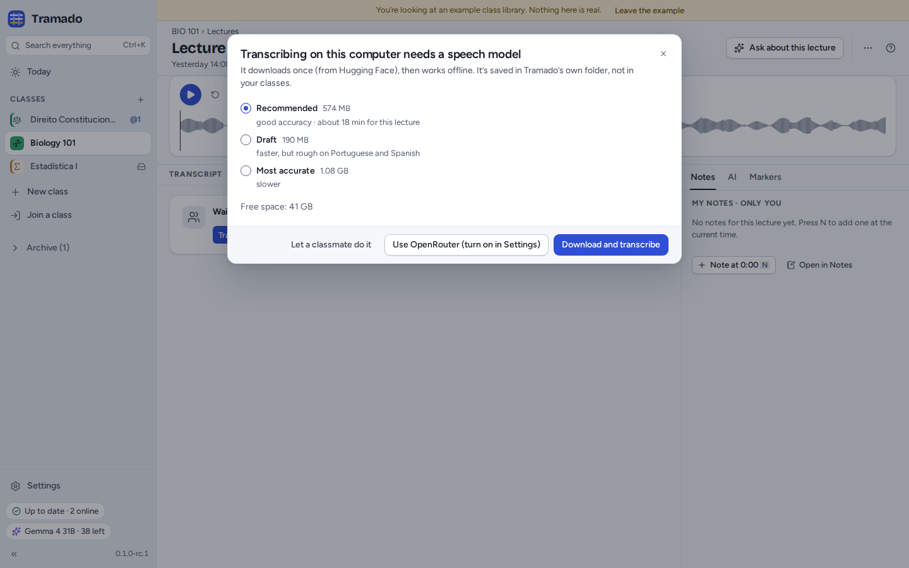
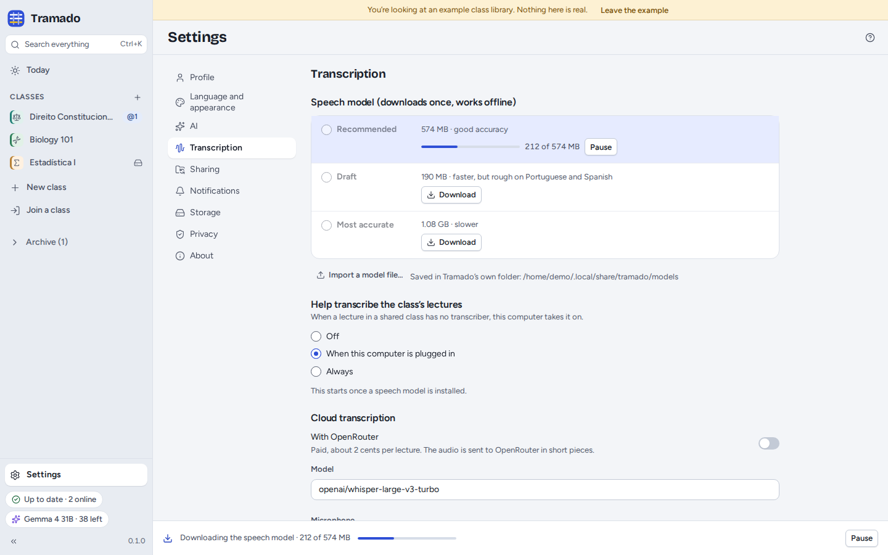
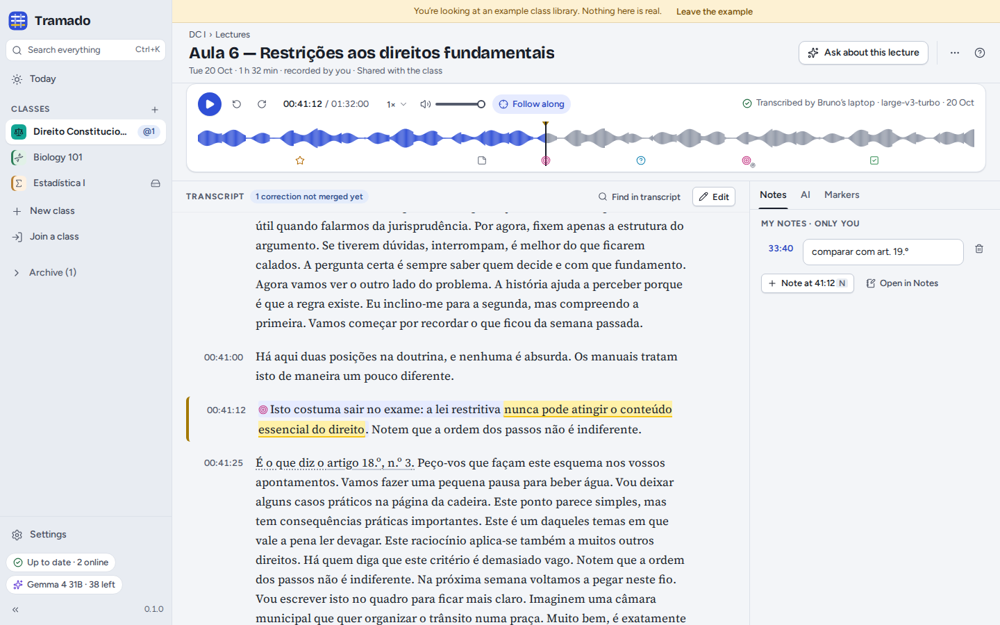
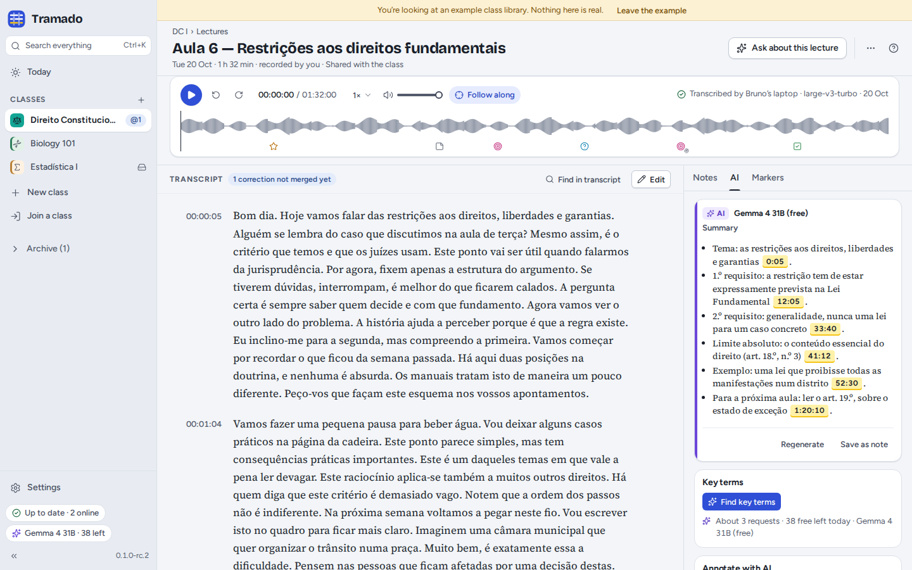

# 3. Lectures

[Contents](index.md) · Previous: [Classes](02-classes.md) · Next: [Documents, notes and search](04-documents-notes-search.md)

## Recording a lecture

**Record lecture** (in a class, or <kbd>Ctrl</kbd>+<kbd>Shift</kbd>+<kbd>R</kbd>) opens the record dialog. It remembers
your answers for each class.

- **Where is the lecture?** *In the room* uses this computer's microphone: sit near the front, close to the lecturer or
  a loudspeaker. *Online* records what your computer plays (Zoom, Teams, Meet…); wear headphones, and tick *Also record
  me* if you want your own questions in it.
- **Language spoken** and **Microphone** (the meter shows what it hears).
- **Permission.** Tick that the lecturer agreed to the recording. In Portugal and Spain, recording someone without
  their consent, or using a recording for more than they agreed to, can be against the law: ask at the start of the
  first lecture; most lecturers say yes for study. With *Remember for this class*, the permission is noted in the
  class, visible to everyone under Members.
- **Share with the class**: *Recording and transcript*, *Transcript only* (the recording stays on this computer) or
  *Nothing yet — I'll decide after*.

If a classmate is already recording the same lecture, Tramado says so: only one recording is transcribed for the class,
but you can record anyway as a backup.

## While recording

The recording bar stays at the bottom of every screen. Mark moments as they happen: <kbd>1</kbd> **Important**,
<kbd>2</kbd> **Didn't get it**, <kbd>3</kbd> **Exam!**, <kbd>4</kbd> **To do**, and <kbd>N</kbd> for a typed note at
the current time. Markers point back a few seconds, because most people press just after the important sentence
(Settings › Transcription changes how far). If you turn on the marker shortcuts in Settings › Transcription,
<kbd>Ctrl</kbd>+<kbd>Alt</kbd>+<kbd>1</kbd>…<kbd>4</kbd> mark while recording from any other app too.

The bar warns you when the microphone hears nothing, the battery runs low or the disk fills up. **Pause** and
**Stop** are on its right. If the computer or Tramado stops in the middle, the recording is kept: at the next start
Tramado offers to keep what was recorded.

**Stop** opens **Save lecture**: give it a title, choose who transcribes it (this computer, a classmate's computer, or
OpenRouter if you turned cloud transcription on) and **Save**.

## Adding a recording you already have

**Add › Add a recording…** takes an audio or video file (MP3, M4A from Zoom or Teams, MP4, OGG, WAV, FLAC, WebM…).
Tramado keeps the sound only, compressed for speech, unless you choose to keep the video too. In a shared class,
confirm that you are allowed to share the recording with the class.

## Transcription

Lectures are transcribed **on your computer** by default, with a speech model that downloads once:

| Model | Size | |
|---|---|---|
| Recommended | 574 MB | good accuracy |
| Draft | 190 MB | faster, but rough on Portuguese and Spanish |
| Most accurate | 1.08 GB | slower |

The model comes from Hugging Face, is checked before use and is kept in Tramado's own folder, not in your classes.
After that, transcription works offline. Tramado tells you about how long a lecture will take on this computer; you can
keep working meanwhile, and the progress shows at the bottom of the window and on Today.
For a classroom without internet, Settings › Transcription › **Import a model file…** takes a model file copied from
a classmate.

**In a shared class, exactly one computer transcribes each lecture**, and everyone gets the same transcript. Classmates
whose computers help transcribe (Settings › Transcription › *Help transcribe the class's lectures*: off, when plugged
in, or always) take lectures that nobody is transcribing; **Transcribe it here** on Today takes one yourself.

**Cloud transcription** (Settings › Transcription) sends the recording to OpenRouter in pieces of up to 30 seconds. It
is paid (about 2 cents per lecture, from your OpenRouter credit) and off until you turn it on. Local transcription
needs a processor with AVX2 (most made since about 2013) or Apple silicon; without one, a classmate's computer or
OpenRouter can transcribe for you.

## The lecture view

- **The player**: play and pause (<kbd>Space</kbd>), back and forward, speed, volume, and **Follow along**, which keeps
  the line being spoken in view. The waveform shows your markers; click anywhere to jump there.
- **The transcript**: click a line's time to play from it. **Find in transcript** searches it. References to articles
  of law (*artigo 18.º*) link to the document that has them.
- **Select text** to **Highlight** it (Important, Didn't get it, Exam, To do, Other), **Comment** on it (only you see
  it), **Explain** it with AI, **Ask…** about it, or **Copy with source**.
- **The side panel**: **Notes** (yours only; <kbd>N</kbd> adds one at the current time), **AI** and **Markers**
  (yours, plus moments where the lecturer said something like "this will be on the exam", found automatically).
- **⋯** has **Copy link to this moment**, **Speakers…** and **Export transcript** as Markdown (`.md`), subtitles
  (`.vtt`) or plain text (`.txt`).

### AI in a lecture

With AI set up, the **AI** tab writes a **Summary** whose points link to the moment they come from, finds **Key terms**,
can **Annotate the transcript** with the lecturer's definitions as private notes, and makes **Study notes** (a private
note with a time link per point). **Ask about this lecture** opens Ask with this lecture as the source.

### Correcting the transcript

Speech models make mistakes, especially with names and terms (add them to the class's *Vocabulary for transcripts*).
**Edit** turns on corrections: click a line to correct it, <kbd>Enter</kbd> saves, <kbd>Esc</kbd> cancels,
<kbd>Alt</kbd>+<kbd>↑</kbd>/<kbd>↓</kbd> moves to the line before or after. A line's menu can change its speaker, split
it or merge it with the next. **Speakers…** names the voices (*Lecturer*, *Class*…) for everyone.

In a shared class, corrections are shared: each line shows who corrected it, and the computer that owns the transcript
merges them a few minutes after the last one. Your highlights, comments and notes stay on the words they were on.

### Other actions

In the Lectures list, a lecture's **⋯** menu can **Rename** it (only on the computer that recorded it),
**Re-transcribe** it, **Mark it as a duplicate** of another (never transcribed automatically), **Delete the recording,
keep the transcript**, **Delete for everyone** or **Remove from this computer only** (your classmates keep it).
