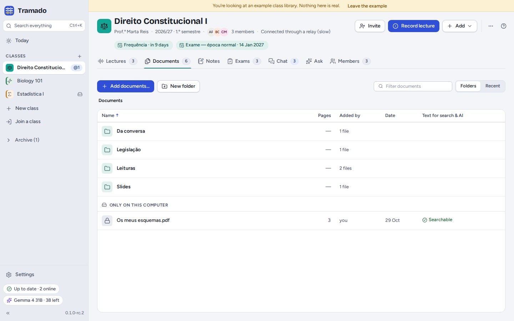
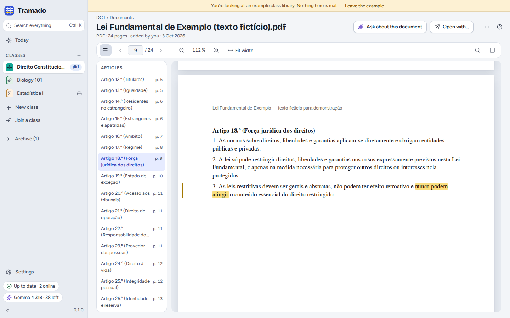
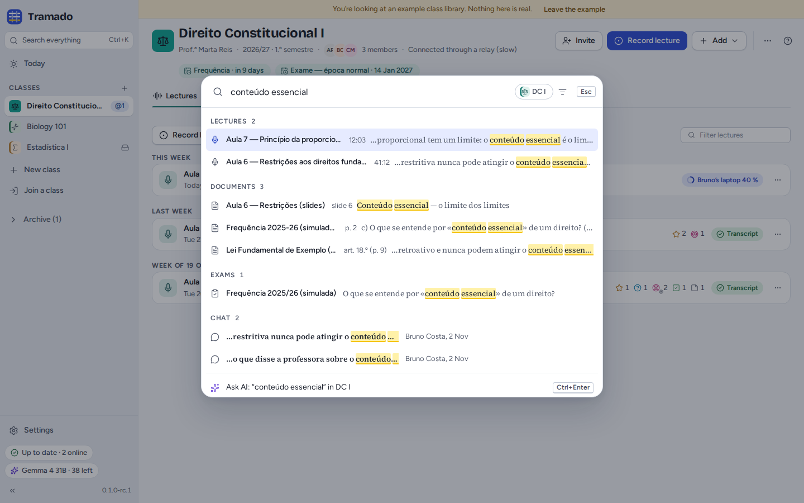

# 4. Documents, notes and search

[Contents](index.md) · Previous: [Lectures](03-lectures.md) · Next: [Exams](05-exams.md)

## Adding documents

Drop files on the window, or use **Add documents…**: PDF, Word (`.docx`), PowerPoint (`.pptx`), OpenDocument text,
RTF, HTML, Markdown, plain text, subtitles and images. Tramado copies them into the class folder and reads their text,
so that search and the AI can use it. The column **Text for search & AI** shows how far it got:

- **Searchable**: done;
- **Reading text… 40 %**: still working (large law codes take a moment);
- **Scan — no text**: the file is a picture of pages. With AI set up, **Read the text with AI** (in the file's menu)
  reads up to 20 pages, one AI request per page.

Tramado notices when a classmate already added the same file, and offers to organise a class's files in folders
(*Slides*, *Readings*, *Legislation*, *Past exams*). In a shared class, a file's menu can **Keep private (only you)…**
(it moves to *Only on this computer*), **Remove from this computer only…** or **Delete for everyone…** (restorable for
30 days from *Recently deleted*).

## Reading a document

PDFs open inside Tramado, with **page** navigation, **zoom**, **Fit width** and **Find in document**. Law texts get a
list of their **Articles** on the left. Select text to **Highlight** it (highlights stay on this computer), **Explain**
it, **Ask** about it or **Copy with source** (*"…" — Constituição, art. 18.º, p. 9*). **Ask about this document** opens
Ask with this document as the source; **Open with…** opens the file in another app. When an AI answer cites a passage,
the document opens on that page with the passage marked.

## Notes

The **Notes** tab has two kinds of notes, both Markdown files:

- **My notes · only you**: on this computer only;
- **Class notes · shared with the class**: in the class folder, everyone can read and edit them.

The toolbar has bold, italic, headings, lists, checklists and links, plus **links to a lecture moment** or **to a
document page**, which open right there. A note's menu can move it between the two kinds. If two people edit the same
class note at the same time, both versions are kept and **Compare** shows them side by side.

## Searching everything

<kbd>Ctrl</kbd>+<kbd>K</kbd> (<kbd>⌘</kbd>+<kbd>K</kbd>), or **Search everything** in the rail, searches the class you
are in, or all classes, at once: lecture transcripts (with the minute), documents (with the page or article), notes,
exam questions and chat messages. <kbd>Enter</kbd> opens a result at the place it was found. The last row, **Ask AI**
(<kbd>Ctrl</kbd>+<kbd>Enter</kbd>), asks the AI the same question about your sources. The palette also runs commands:
type what you want to do (for example *settings*) or a class's name.

Search works without AI and without internet. Accents and capitals do not matter.
