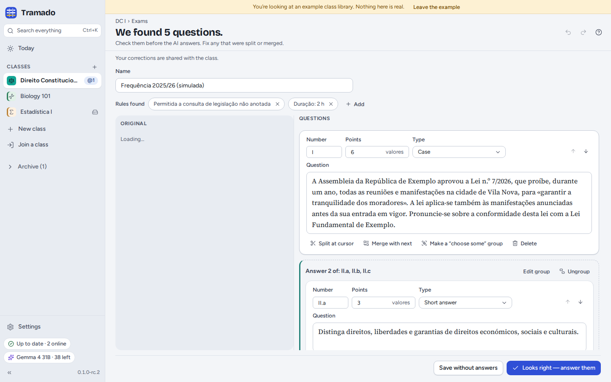
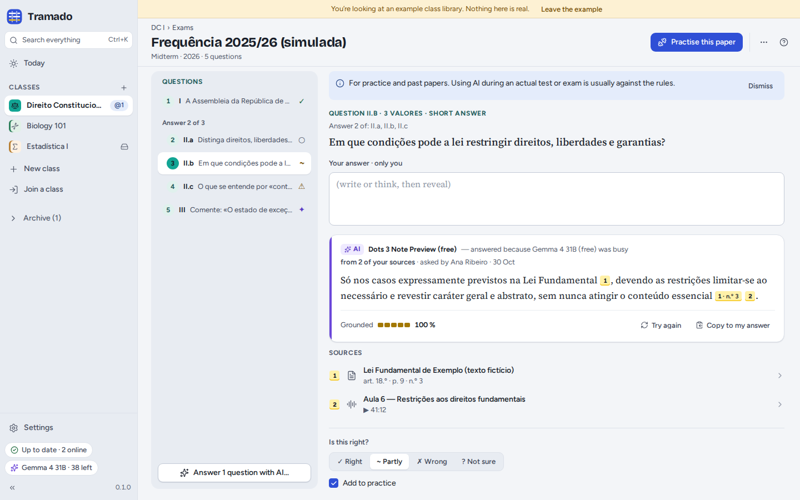
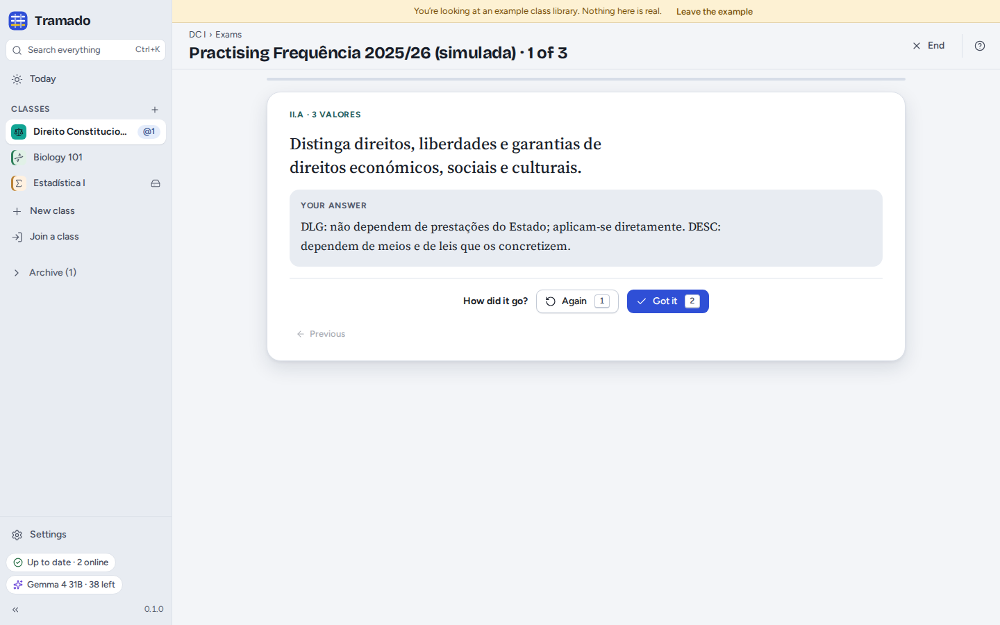

# 5. Exams

[Contents](index.md) · Previous: [Documents, notes and search](04-documents-notes-search.md) · Next: [Class groups](06-class-groups.md)

The **Exams** tab keeps the dates of tests and exams, and past exam papers or practice questions to practise with.

## Exam dates

**Add › An upcoming test or exam**: its kind (quiz, test, midterm, final exam, resit…), name, date and time (leave the
time empty for an all-day date), room, what it covers and its weight. Tramado counts down to it on **Today** and in the
class header. In a shared class everyone sees the date.

## Exam papers

**Add › An exam paper or practice questions**: drop a PDF, a Word file or photos of the paper, or **Type or paste the
questions**. **Find the questions** uses AI: Tramado says beforehand how many requests it will take (one per page to
read, plus one to find the questions) and how many free requests you have left today. Without AI, type the questions
yourself. You can leave the screen while it reads; Tramado keeps going.

### Checking the questions

Before anything is answered, you check what was found, next to the original: each question's **number**, **points**,
**type** and **text**. Fix questions that were split or merged (**Split at cursor**, **Merge with next**), group "answer
two of three" questions (**Make a "choose some" group**), and keep or remove the **rules found** (for example *open
book*, *2 hours*). Then **Looks right — answer them**, or **Save without answers**. In a shared class your corrections
are shared.

### Answers with sources

Choose how the AI answers (from your class materials only, or with general knowledge marked as unverified) and whether
you want to **try each question yourself first** (recommended: answering before you look is what makes it stick). Then,
for each question:

- write your answer under **Your answer · only you**, or just think it through;
- **Show the AI's answer**. Every claim carries a numbered **citation**: hover it to see the passage, click it to open
  the page of the document, the article of law or the moment of the lecture. **Grounded** shows how much of the answer
  is backed by your sources; sentences that are not in your materials are marked;
- mark it **Right**, **Partly**, **Wrong** or **Not sure**, add the correct answer if you know it, and **Add to
  practice**.

The AI card says which model answered, and when the default free model was busy and another one answered instead. In a
shared class the AI answers are shared, so classmates do not spend their own requests on the same questions.

> For practice and past papers. Using AI during an actual test or exam is usually against the rules.

## Practice

**Practise this paper**, or **Practise** on Today, shows one question at a time. Think or write your answer,
<kbd>Space</kbd> shows the answer, then say how it went: **Again** (<kbd>1</kbd>) or **Got it** (<kbd>2</kbd>).
Questions you got wrong come back the next day. Your practice stays on your computer.
