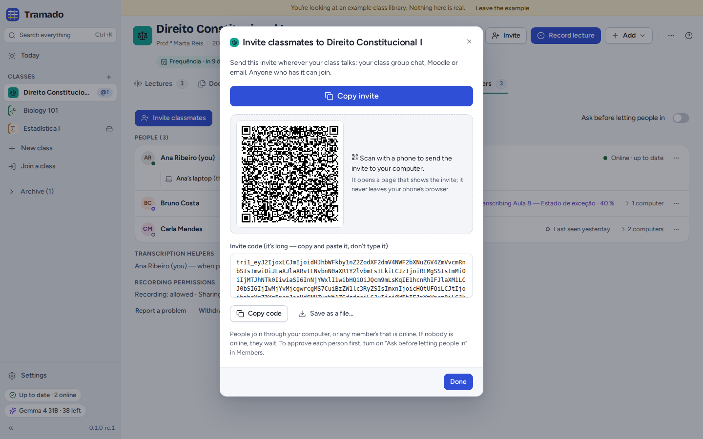
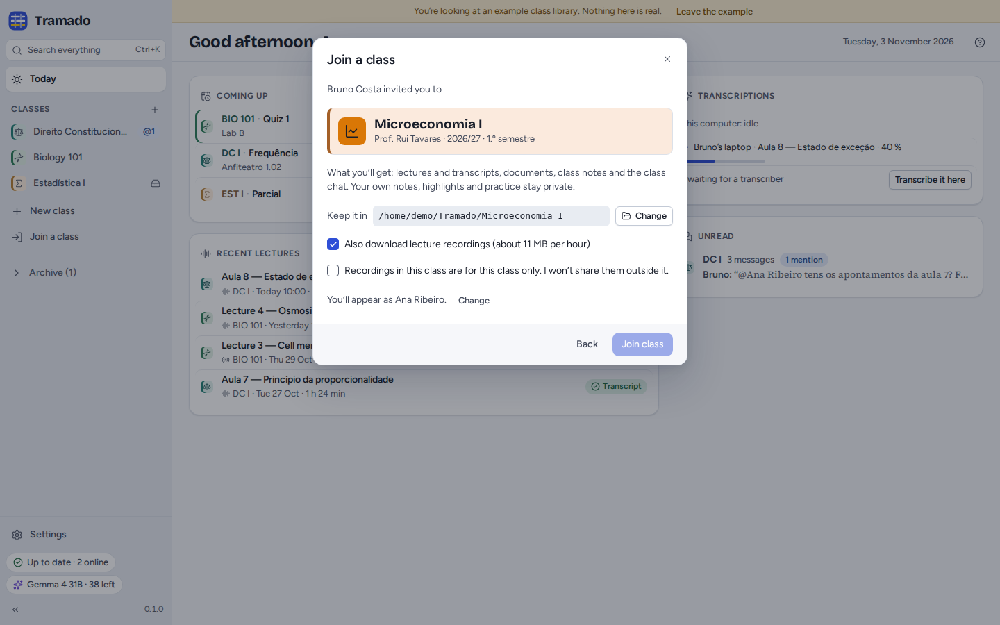
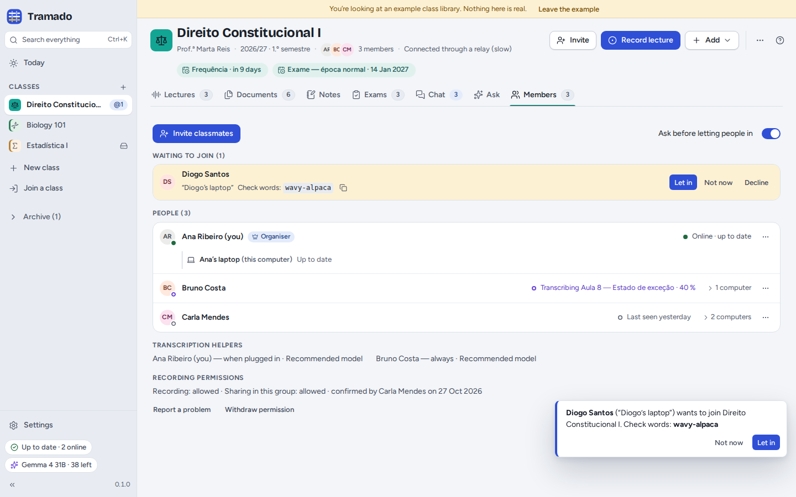
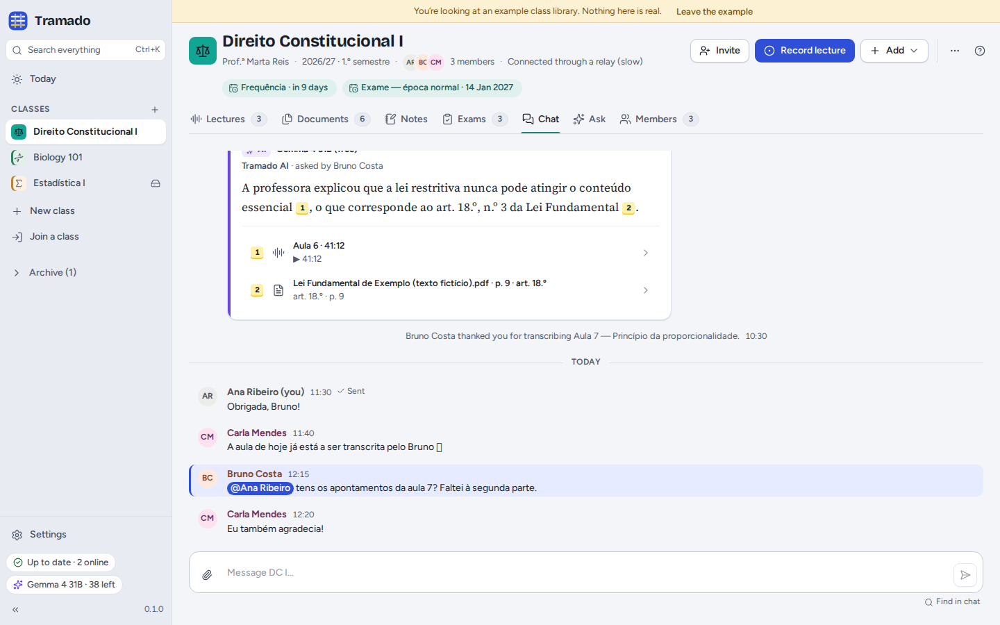
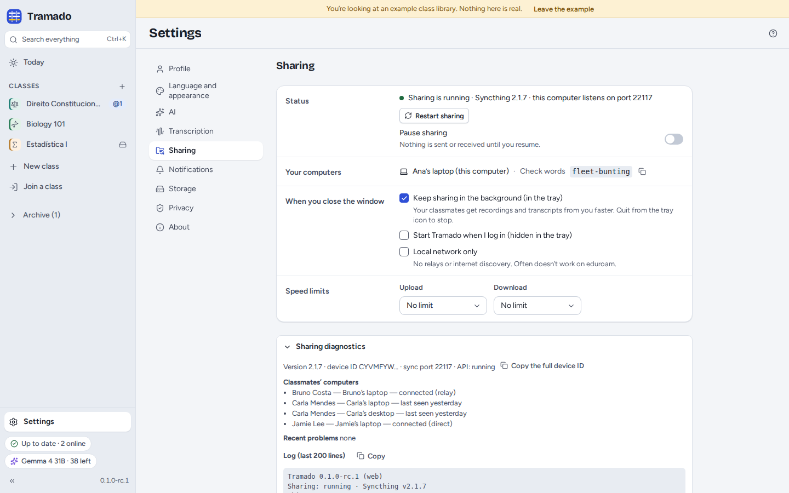

# 6. Class groups

[Contents](index.md) · Previous: [Exams](05-exams.md) · Next: [AI](07-ai.md)

Share a class and your classmates get the same class folder: lectures and transcripts, documents, class notes, exam
papers and shared AI answers, and a class chat. Your own notes, highlights, practice and Ask conversations are never
part of it.

There is no Tramado server. Sharing runs on [Syncthing](https://syncthing.net), which comes inside Tramado: files travel
encrypted, directly between your classmates' computers, whenever two of them are online at the same time. To find each
other across networks, the computers use Syncthing's public discovery and relay servers; see
[Settings and privacy](08-settings-and-privacy.md).

## Sharing a class

Turn on **Share with classmates** when you create a class, or later use the class's **Share** tab (or **⋯ › Share this
class…**). The first time, Tramado asks whether to **keep sharing in the background** when you close the window:
classmates then get recordings and transcripts from you sooner. You can change this in Settings › Sharing.

## Inviting classmates

**Invite** (in the class header or in Members) shows the invite:

- **Copy invite** copies a short message with a link and the code: paste it in your class group chat, Moodle or an
  e-mail. The link opens Tramado's join page (`https://feiteira.github.io/Tramado/join/`) in the browser;
- the **QR code** opens the same page on a phone that scans it;
- **Copy code** copies the code alone, and **Save as a file…** saves a `.tramado-invite` file, which **Join a class ›
  Open an invite file…** reads.

The join page shows the class and who sent the invite. On a computer with Tramado, **Open in Tramado** opens the
invite in **Join a class**; on a phone, choose **Copy code**, send the code to your computer (by e-mail, or a messaging
app you also use on the computer) and paste it in **Join a class**. The invite is in the part of the link after `#`,
which the browser never sends to a server: the page reads it on your device and sends nothing anywhere.

Anyone who has the invite can join, through your computer or any member's computer that is online; if nobody is online,
they wait. To approve each person first, an organiser turns on **Ask before letting people in** in Members.

## Joining a class

**Join a class** (in the rail, or <kbd>Ctrl</kbd>+<kbd>Shift</kbd>+<kbd>J</kbd>): paste the invite (the whole
message is fine) or open an invite file, and **Continue**. (A link opens the join page first: there, **Open in
Tramado** opens this window with the invite already in it.) Tramado shows the class and who invited you. Choose where
to keep it, whether to **also download lecture recordings** (about 11 MB per hour; you get every transcript either way)
and agree that recordings in this class are for this class only. Then **Join class**.

Tramado shows your **check words** (for example *wavy-alpaca*). If the class asks before letting people in, a member
sees the same words next to your name: say them aloud or in the class group, so they know it is really you. You can
close the window while you wait; Tramado tells you when you are in, and the files start arriving.

## Members

The **Members** tab lists:

- **Waiting to join** (when the class asks first): **Let in**, **Not now** or **Decline**. Compare the check words
  first.
- **People**, with who is online, what they are doing (for example transcribing a lecture) and their computers.
  Organisers can **Make organiser** and **Remove from class…**: everyone's Tramado then stops sharing the class with
  that person's computers (they keep what they already have), and newcomers must be let in from then on.
- **Transcription helpers**: who transcribes the class's lectures automatically, and with which model.
- **Recording permissions**: the lecturer's permission on record, who confirmed it and when; **Withdraw permission**
  stops new recordings from being shared.

If nobody organises the class any more (the organisers left), any member can **Become an organiser**.

## The class chat

Write to the class in **Chat**. Reply to a message, mention someone with **@**, or ask **@AI**: Tramado answers from
the class's lectures and documents with your own AI key, citing its sources, and everyone sees the answer (classmates'
keys are never shared). Files you attach are also kept in **Documents › From chat**. A message shows **✓ Sent** once at
least one classmate's computer has it; until then it is saved and waits.

## Syncing and problems

The **sharing pill** at the bottom of the rail says how sharing is going: *Up to date · 2 online*, *Syncing 3 files*,
*Waiting for classmates* (nobody is online: changes are kept and sync later), *Sharing paused*, or *Sharing isn't
running*. Click it for details. On eduroam and other campus networks computers often cannot reach each other directly;
they then go through a relay, which is slower (*Connected through a relay (slow)* in the class header).

When two people change the same file at the same time, both versions are kept (the other one is marked *Conflict
copy*). A class's **⋯ › Recently deleted…** restores deleted files for 30 days.

## Settings › Sharing

- **Status**: whether sharing is running, with **Restart sharing** and **Pause sharing**.
- **Your computers**: this computer and its check words. (Adding a second computer of yours is planned for a later
  version.)
- **When you close the window**: keep sharing in the background (in the tray), and start Tramado when you log in.
- **Local network only**: no relays and no internet discovery (often does not work on eduroam).
- **Speed limits** for upload and download.
- **Sharing diagnostics**: version, ports, classmates' computers and how they connect, recent problems and the log, to
  copy into a bug report.
