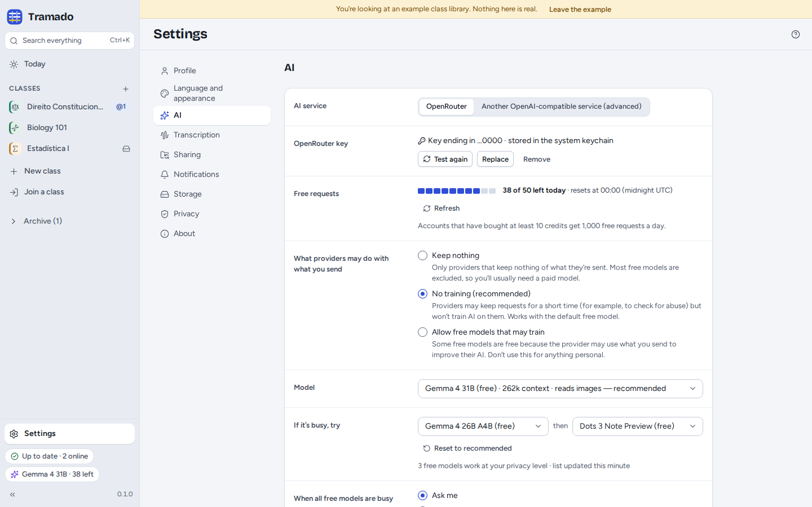
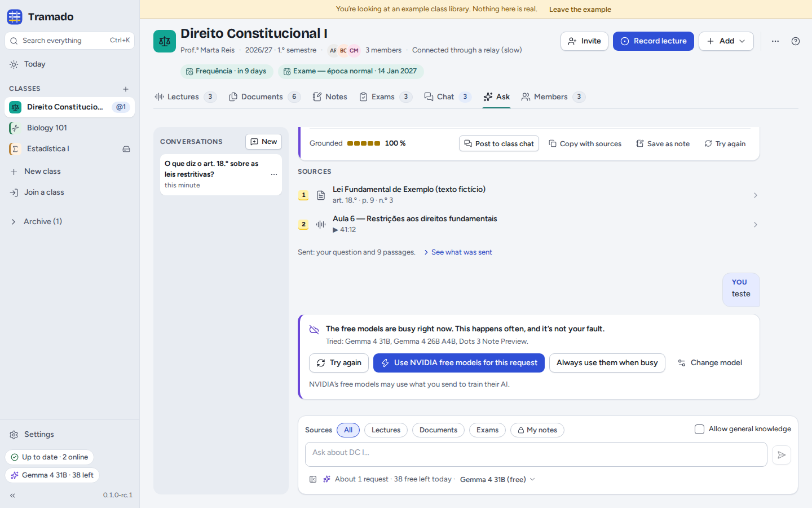
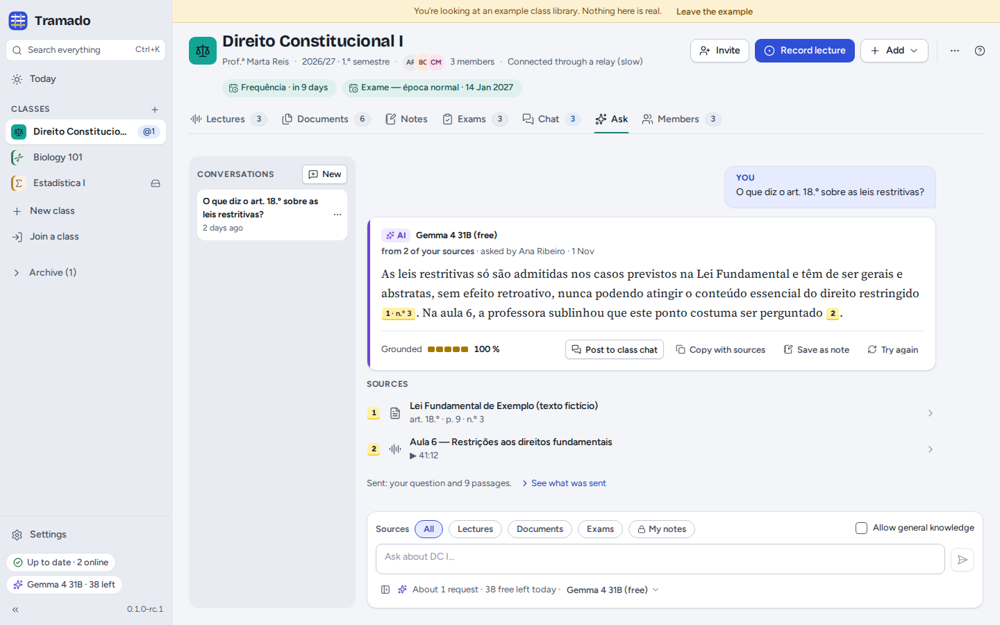

# 7. AI

[Contents](index.md) · Previous: [Class groups](06-class-groups.md) · Next: [Settings and privacy](08-settings-and-privacy.md)

AI is optional. Without it you can still record, transcribe, search, take notes, share and practise; the AI buttons
are simply hidden. With it, Tramado answers exam questions, explains passages, summarises lectures, reads scanned pages
and answers questions about your classes, always **from your own class material, with citations**.

## Setting it up

Tramado uses [OpenRouter](https://openrouter.ai), a service that gives access to many AI models with one key. You
use **your own key**, and free models work:

1. Create a free key at [openrouter.ai/keys](https://openrouter.ai/keys).
2. Paste it in Settings › AI (or in the first-start step) and press **Test and save**.

> OpenRouter is for people aged **18 or over**. If you are younger, do not use it: skip AI, or connect another service
> (see [below](#another-service-local-ai)).

The key is kept in your system's keychain (or, if there is none, in a private file only you can read), and it never
reaches the app's window: Tramado adds it to each request itself.

### Free requests

Free models are free, but limited: 50 requests a day for accounts that never bought credit, 1,000 a day after buying
at least 10 credits, and about 20 a minute. Settings › AI and the AI pill show how many are left today (the count
resets at midnight UTC). Before anything that takes several requests (reading a scanned exam, answering a whole paper)
Tramado says how many it will use.

### The model

The default is **Gemma 4 31B (free)** (`google/gemma-4-31b-it:free`). **If it's busy, try** lists two other free models
Tramado tries next; **Reset to recommended** restores them. Each answer says which model wrote it.

Free models are often busy. When all of them are, Tramado tells you and offers to **Try again**, to **Use NVIDIA free
models for this request** or to change the model. NVIDIA's free models may use what you send to train their AI, so
Tramado never switches to them without asking, unless you choose **Always use them when busy**.

### What providers may do with what you send

| Level | Meaning |
|---|---|
| **Keep nothing** | Only providers that keep nothing of what they are sent. Most free models are excluded: you will usually need a paid model. |
| **No training (recommended)** | Providers may keep requests for a short time (for example to check for abuse) but do not train AI on them. Works with the default free model. |
| **Allow free models that may train** | Some free models are free because the provider may use what you send to improve their AI. Do not use this for anything personal. |

Making the level less strict always asks for your confirmation in a separate window.

## What the AI receives

Only what a question needs: your question and the **passages** of your sources that answer it (with their file names
and page numbers or times). Never a whole folder, never your private notes unless you include *My notes*, never the
chat history or other classes. Under each answer, **See what was sent** lists exactly what went out. Settings ›
Privacy keeps a log of every request made from this computer.

## Ask

The **Ask** tab of a class (or **Ask AI** in all classes, from the search palette) is a conversation about your
material. Choose the **Sources** (all,
lectures, documents, exams, or *My notes*), and whether to **Allow general knowledge** (sentences not found in your
materials are then marked as unverified). Answers carry citations and a **Grounded** score. From an answer you can
**Post to class chat**, **Copy with sources**, **Save as note** or **Try again**. Conversations stay on this computer.

AI also works elsewhere: **Explain** on selected text, the **AI** tab of a lecture, **Ask AI** in the search palette,
**@AI** in the chat, and exam answers ([Exams](05-exams.md)).

## Another service (local AI)

**Settings › AI › Another OpenAI-compatible service (advanced)** connects any service that speaks the OpenAI API:
[Ollama](https://ollama.com) or [LM Studio](https://lmstudio.ai) on your own computer, or a server your school runs.
Enter its **Address**, a **Key** if it needs one, and the **Model**, then **Test**. Plain `http` works only for your
own computer and your local network; Tramado asks you to confirm each new address in a separate window. What the
service does with your data depends on who runs it.

## Turning AI off

**Turn off AI on this computer** (Settings › AI) hides every AI button; your key stays saved.
