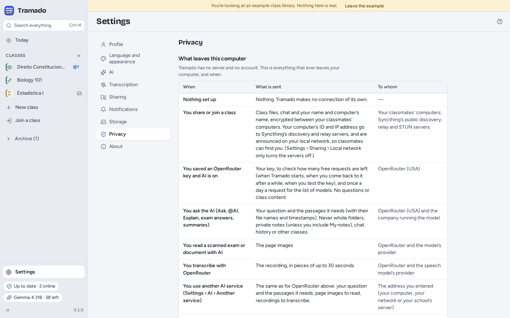

# 8. Settings and privacy

[Contents](index.md) · Previous: [AI](07-ai.md)

**Settings** is at the bottom of the rail (<kbd>Ctrl</kbd>+<kbd>,</kbd>).

## The sections

- **Profile**: your name (classmates see it in every class you share), this computer's name and your colour.
  Classmates see your name and your computers' names, never a phone number or an e-mail address.
- **Language and appearance**: English, Português (Portugal) or Español (España); a light, dark or system theme; text
  size; the font (the default, *Atkinson Hyperlegible Next* to read more easily, or *OpenDyslexic*); reduce motion.
- **AI**: your key, the privacy level, the model and its fallbacks, the answer language, another service, and turning
  AI off. See [AI](07-ai.md).
- **Transcription**: speech models, helping the class transcribe, cloud transcription, the microphone and its test,
  recording quality (*Standard*, about 11 MB per hour, or *Storage saver*, about 7 MB per hour), how far markers point
  back, and the marker shortcuts that work from any app. See [Lectures](03-lectures.md#transcription).
- **Sharing**: see [Class groups](06-class-groups.md#settings--sharing).
- **Notifications**: system notifications, and what to be told about (a transcript you are waiting for, someone
  joining, an exam date added or changed, a speech model downloaded). Each class can change this in its **⋯ ›
  Notifications** menu.
- **Storage**: where new classes are created; each class's size (recordings, and deleted files kept for 30 days) with
  **Empty class trash** and **Skip audio**; the speech models; the cache (text for search, indexes), which rebuilds
  itself; and whether to remove recordings you made once they are transcribed (never, after 30 or after 90 days; the
  transcript stays).
- **Privacy**: below.
- **About**: the version, the licence and the source code; **Keyboard shortcuts**; **Copy diagnostics** (nothing is
  sent); **Test audio playback**; the licences of the software Tramado includes.

## What leaves your computer

Tramado has no server and no account. Settings › Privacy lists everything that ever leaves your computer, and when.
The same table is in the repository as [PRIVACY.md](../../../PRIVACY.md) ([Português](../../../PRIVACY.pt.md) ·
[Español](../../../PRIVACY.es.md)). In short:

- **Nothing**, until you share a class, turn on AI or download a speech model. No telemetry, no analytics, no crash
  reports; Syncthing's usage reporting is off.
- **Sharing a class** sends class files, the chat, your name and your computer's name, encrypted, to your classmates'
  computers. Your computer's ID and IP address go to Syncthing's discovery and relay servers and are announced on the
  local network so classmates can find you (*Local network only* turns the servers off).
- **AI** sends your question and the passages it needs to OpenRouter and the company running the model (or to the
  service you set up). With a key saved and AI on, Tramado also checks how many free requests are left, and once a day
  fetches the list of models.
- **Transcribing with OpenRouter** sends the recording in pieces of up to 30 seconds; **reading a scan with AI** sends
  the page images.
- **Downloading a speech model** sends a download request to Hugging Face.

**AI activity on this computer** is a private log of every AI request made from here (time, class, action, model,
passages sent). It is never sent anywhere; **Clear the log** empties it.

## Where your files are

- **Your classes** are ordinary folders, by default in `Tramado` in your home folder (Settings › Storage changes where
  new ones go).
- **Tramado's private data** (your own notes, highlights, practice, Ask conversations, the AI activity log), the speech
  models and the cache are in Tramado's own folders on this computer, and are never shared. On Linux these are
  `~/.local/share/eu.thehumanloop.tramado`, `~/.config/eu.thehumanloop.tramado` and
  `~/.cache/eu.thehumanloop.tramado`. Settings › Privacy › *Where your data is* opens each of them.
- **Your OpenRouter key** is in the system keychain, or in a private file in Tramado's settings folder when there is no
  keychain.
