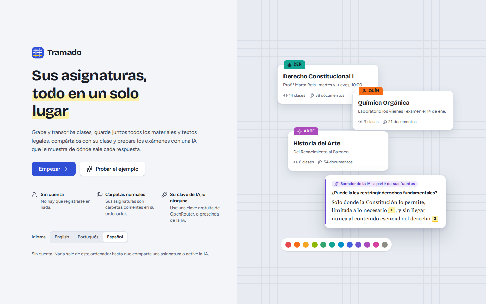
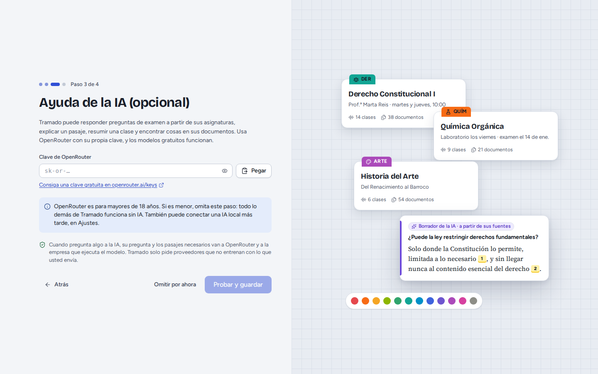
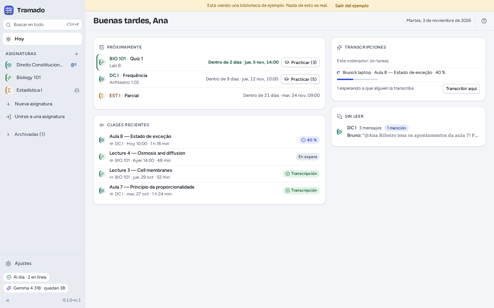

# 1. Primeros pasos

[Índice](index.md) · Siguiente: [Asignaturas](02-classes.md)

## Instalar

- **Linux**: el `.AppImage` funciona en la mayoría de las distribuciones (hágalo ejecutable y ábralo); el `.deb` es
  para Debian y Ubuntu. Los dos incluyen Tramado, el programa Syncthing, que comparte las asignaturas, y el pequeño
  modelo que encuentra la voz en las grabaciones.
- **Windows y macOS**: los instaladores se generan automáticamente, pero todavía no se han probado. No están firmados:
  SmartScreen de Windows pide confirmación (*Más información › Ejecutar de todas formas*); en macOS, abra la aplicación
  una vez y después *Ajustes del Sistema › Privacidad y seguridad › Abrir igualmente*.

El modelo de voz que transcribe las clases no viene en el instalador: Tramado lo descarga la primera vez que transcribe
(véase [Clases](03-lectures.md#transcripción)).

## El primer inicio

Elija el idioma abajo y después **Empezar**. (**Probar el ejemplo** abre una biblioteca de asignaturas ficticias: véase
[más abajo](#la-biblioteca-de-ejemplo).) Siguen tres pasos cortos:

1. **Su nombre**, tal como lo verán los compañeros junto a sus mensajes y grabaciones, y el nombre de este ordenador.
   La línea de debajo indica dónde se guardan las asignaturas (una carpeta llamada `Tramado` en su carpeta personal);
   **Cambiar…** elige otro sitio. Evite una carpeta que ya sincronicen Dropbox, OneDrive o Google Drive: Tramado le
   avisa si elige una.
2. **Ayuda de la IA (opcional).** Pegue una clave de OpenRouter y pulse **Probar y guardar**, u **Omitir por ahora**.
   Todo funciona sin ella, salvo las funciones de IA. OpenRouter es para mayores de 18 años; si es menor, omita este
   paso (puede conectar un servicio de IA local más adelante). Véase [IA](07-ai.md).
3. **Todo listo**: cree su primera asignatura, o únase a una con la invitación que le ha enviado un compañero.

## La pantalla Hoy

**Hoy** reúne lo que le necesita ahora:

- **Próximamente**: las pruebas y los exámenes de las próximas semanas, con cuenta atrás y **Practicar** en las
  asignaturas con preguntas para practicar.
- **Transcripciones**: lo que están transcribiendo este ordenador y los de los compañeros, y las clases que esperan a
  alguien que las transcriba (**Transcribir aquí**).
- **Clases recientes** y los mensajes y menciones **Sin leer** en los chats de sus asignaturas.

A la izquierda, la **barra lateral**: **Buscar en todo** (<kbd>Ctrl</kbd>+<kbd>K</kbd>), **Hoy**, sus **asignaturas**
(<kbd>Ctrl</kbd>+<kbd>1</kbd>…<kbd>9</kbd> las abre), **Nueva asignatura**, **Unirse a una asignatura**, el **Archivo**
y los **Ajustes**. Abajo, dos indicadores de estado:

- el de **sincronización** (por ejemplo *Al día · 2 en línea*, *Sincronizando 3 archivos*, *Esperando a los
  compañeros*): haga clic en él para ver detalles y problemas;
- el de la **IA**, con su modelo y las solicitudes gratuitas que le quedan hoy.

## La biblioteca de ejemplo

**Probar el ejemplo**, en la pantalla de bienvenida, abre una biblioteca de asignaturas ficticias (Derecho
Constitucional en portugués, Biología en inglés, Estadística en español) con clases, documentos, exámenes y un chat de
clase, para probarlo todo sin grabar ni compartir nada. Una franja amarilla recuerda que nada de eso es real; **Salir
del ejemplo** vuelve a su biblioteca (a la pantalla de bienvenida, si todavía no ha configurado Tramado). No se guarda
nada de lo que haga en el ejemplo.

## Ayuda

<kbd>F1</kbd> o <kbd>?</kbd> muestra los atajos de teclado; entre ellos, <kbd>Ctrl</kbd>+<kbd>Mayús</kbd>+<kbd>R</kbd>
empieza o termina una grabación y <kbd>Ctrl</kbd>+<kbd>,</kbd> abre los Ajustes (<kbd>⌘</kbd> en lugar de
<kbd>Ctrl</kbd> en un Mac). En Ajustes › Acerca de están **Copiar diagnóstico** (un resumen para informar de un error,
sin nada del contenido de sus asignaturas; no se envía nada) y **Probar la reproducción de audio**.
