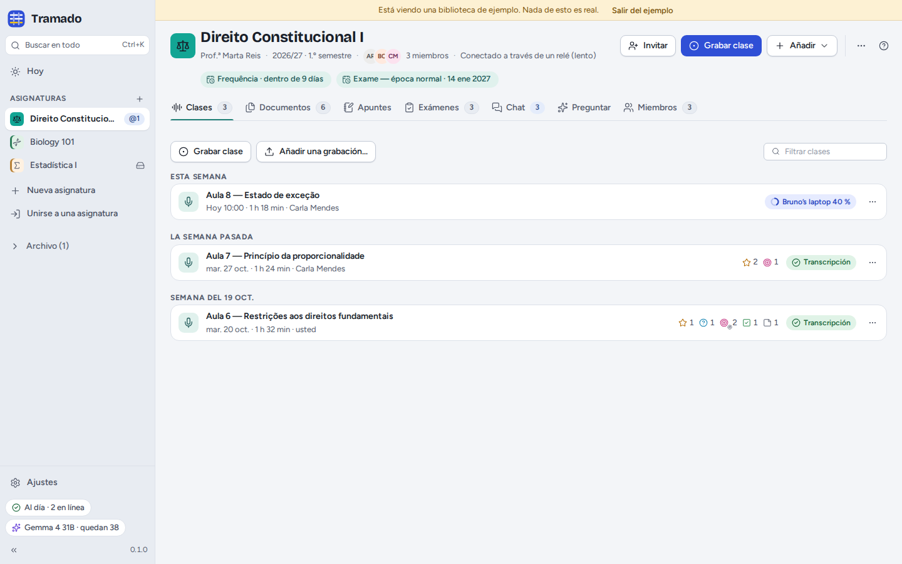
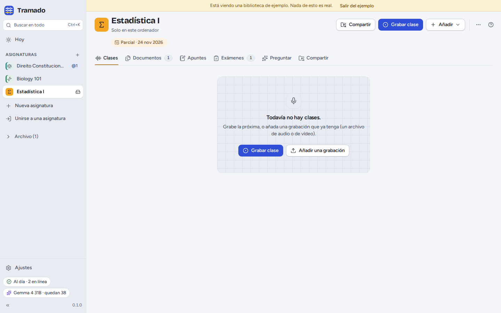

# 2. Asignaturas

[Índice](index.md) · Anterior: [Primeros pasos](01-getting-started.md) · Siguiente: [Clases](03-lectures.md)

Una **asignatura** es una materia que está cursando. Todo lo suyo vive en una carpeta normal de su ordenador, que puede
abrir, copiar o incluir en una copia de seguridad como cualquier otra.

## Crear una asignatura

**Nueva asignatura**, en la barra lateral (o <kbd>+</kbd> junto a *Asignaturas*), abre un breve formulario:

- **Nombre** (por ejemplo *Teoria Geral do Direito Civil*) y un **Nombre corto** para el chat, las notificaciones y
  los espacios estrechos;
- **Color** e **Icono**, para reconocer la asignatura en todas partes;
- **Profesor/a** y **Periodo** (opcionales);
- **Idioma en que se dan las clases**, para las transcripciones y las respuestas de la IA (o *Detectar
  automáticamente*);
- **Compartir con los compañeros**: activado, los compañeros a los que invite reciben las clases, los documentos, los
  apuntes compartidos y el chat; desactivado, la asignatura se queda solo en este ordenador, y puede compartirla más
  tarde (véase [Grupo de la asignatura](06-class-groups.md));
- **Vocabulario para las transcripciones**: nombres y términos que usa el profesor (por ejemplo *Gomes Canotilho, quid
  iuris*), para que el modelo de voz los escriba bien.

## La pantalla de la asignatura

La cabecera muestra el nombre de la asignatura, el profesor y el periodo, los miembros, las próximas fechas de examen y
el estado de la sincronización. Sus botones:

- **Invitar** (asignaturas compartidas) o **Compartir** (asignaturas solo en este ordenador);
- **Grabar clase**;
- **Añadir**: documentos, una grabación, una fecha de examen, un enunciado, apuntes propios o compartidos;
- **⋯**: **Ajustes de la asignatura…** (el mismo formulario, más *Preguntar antes de dejar entrar* y *No guardar los
  archivos de audio en este ordenador* en las asignaturas compartidas), **Notificaciones**, **Eliminados
  recientemente…**, **Abrir la carpeta**, **Archivar**, **Salir de la asignatura…** y **Eliminar la asignatura…**.

Las pestañas: **Clases**, **Documentos**, **Apuntes**, **Exámenes**, **Chat**, **Preguntar** y **Miembros** (una
asignatura solo en este ordenador tiene **Compartir** en lugar de Chat y Miembros).

## La carpeta de la asignatura

La carpeta de una asignatura contiene `Clases`, `Documentos`, `Exámenes` y `Apuntes` (con los nombres en el idioma de
quien creó la asignatura: `Lectures`, `Documents`, `Exams`, `Notes` en inglés; `Aulas`, `Documentos`, `Exames`, `Apontamentos`
en portugués), y una carpeta oculta `.tramado` con los registros propios de la asignatura (miembros, chat, reservas de
transcripción, correcciones…). Cada clase es una carpeta con su grabación (`audio.webm`) y su transcripción
(`transcript.md`, `transcript.vtt`). Puede cambiar el nombre de estas carpetas en el gestor de archivos: Tramado
encuentra sus archivos por su contenido, no por su nombre. No toque `.tramado`.

Lo suyo **no** está en la carpeta de la asignatura: sus apuntes y resaltados, su práctica, sus conversaciones con la IA
y el registro de actividad de la IA se quedan en los datos del propio Tramado, en este ordenador. Solo llegan a los
compañeros si pasa unos apuntes a los compartidos o publica una respuesta en el chat.

## Eliminados recientemente

En una asignatura compartida, los archivos que elimine usted o un compañero se pueden restaurar para todos durante 30
días desde **⋯ › Eliminados recientemente…**. Si desaparecen muchos archivos a la vez de la carpeta de una asignatura
compartida, fuera de Tramado (más de 20 en 10 segundos), la sincronización de esa asignatura se pausa y Tramado le
pregunta si era eso lo que quería antes de tocar las copias de los compañeros.

## Archivar, salir, eliminar

- **Archivar** pasa una asignatura que ya no sigue al **Archivo** de la barra lateral, completa; **Desarchivar** la
  recupera.
- **Salir de la asignatura…** (asignaturas compartidas) deja de recibir actualizaciones. Su copia se queda en este
  ordenador, salvo que marque *Eliminar también mi copia de este ordenador*. Lo que añadió se queda con los compañeros:
  quítelo antes de salir si quiere que desaparezca.
- **Eliminar la asignatura…** borra de este ordenador la carpeta y todo lo que contiene, después de escribir el nombre
  de la asignatura. No se puede deshacer.
