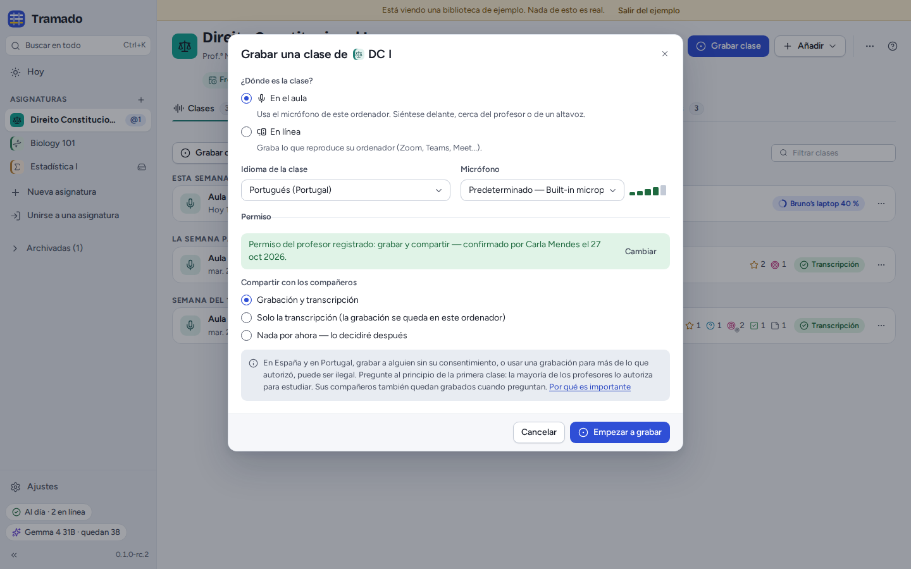
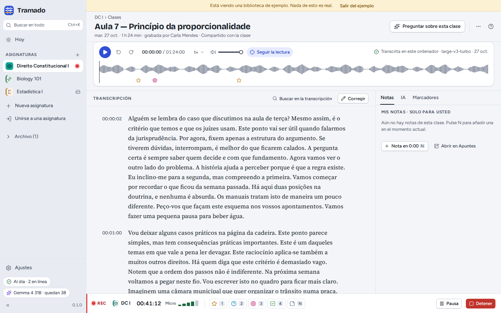
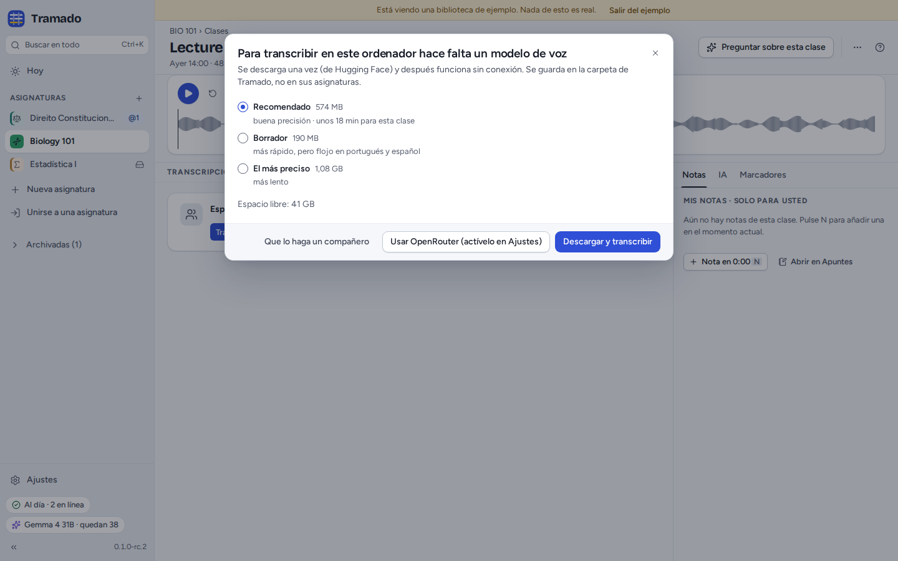
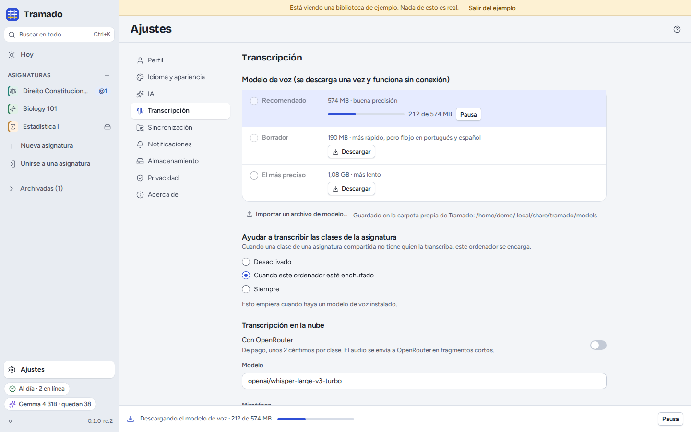
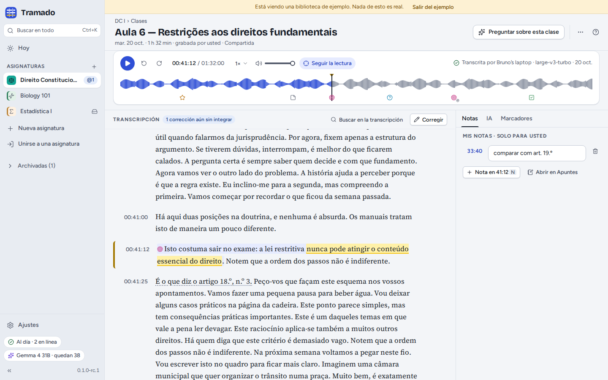
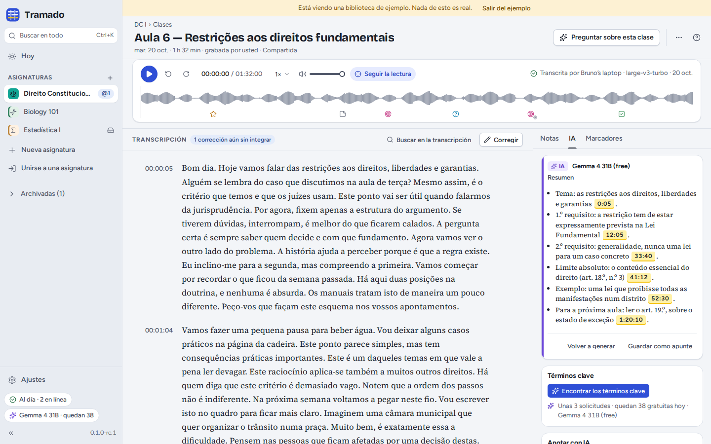

# 3. Clases

[Índice](index.md) · Anterior: [Asignaturas](02-classes.md) · Siguiente: [Documentos, apuntes y búsqueda](04-documents-notes-search.md)

## Grabar una clase

**Grabar clase** (en una asignatura, o <kbd>Ctrl</kbd>+<kbd>Mayús</kbd>+<kbd>R</kbd>) abre la ventana de grabación,
que recuerda sus respuestas para cada asignatura.

- **¿Dónde es la clase?** *En el aula* usa el micrófono de este ordenador: siéntese delante, cerca del profesor o de un
  altavoz. *En línea* graba lo que reproduce el ordenador (Zoom, Teams, Meet…); use auriculares y marque *Grabarme
  también a mí* si quiere que sus preguntas queden en la grabación.
- **Idioma de la clase** y **Micrófono** (el medidor muestra lo que oye).
- **Permiso.** Confirme que el profesor ha autorizado la grabación. En Portugal y en España, grabar a alguien sin su
  consentimiento, o usar una grabación para algo más de lo que autorizó, puede ser ilegal: pregunte al principio de la
  primera clase; la mayoría de los profesores acepta si es para estudiar. Con *Recordar para esta asignatura*, el
  permiso queda registrado en la asignatura, visible para todos en Miembros.
- **Compartir con la clase**: *Grabación y transcripción*, *Solo la transcripción* (la grabación se queda en este
  ordenador) o *Nada por ahora — lo decidiré después*.

Si un compañero ya está grabando la misma clase, Tramado se lo dice: solo se transcribe una grabación para el grupo,
pero puede grabar igualmente, como copia de reserva.

## Durante la grabación

La barra de grabación se queda en la parte inferior de todas las pantallas. Marque los momentos según ocurren:
<kbd>1</kbd> **Importante**, <kbd>2</kbd> **No lo entendí**, <kbd>3</kbd> **¡Examen!**, <kbd>4</kbd> **Pendiente**, y
<kbd>N</kbd> para escribir una nota en el momento actual. Los marcadores retroceden unos segundos, porque casi todo el
mundo pulsa justo después de la frase importante (puede cambiar cuánto en Ajustes › Transcripción). Si activa los
atajos de los marcadores en Ajustes › Transcripción, <kbd>Ctrl</kbd>+<kbd>Alt</kbd>+<kbd>1</kbd>…<kbd>4</kbd> también
marcan desde cualquier otra aplicación durante la grabación.

La barra avisa cuando el micrófono no oye nada, la batería se agota o el disco se llena. **Pausa** y **Detener** están a
la derecha. Si el ordenador o Tramado se detienen a mitad, la grabación no se pierde: en el siguiente inicio Tramado
ofrece conservar lo grabado.

**Detener** abre **Guardar clase**: póngale un título, elija quién la transcribe (este ordenador, el ordenador de un
compañero, u OpenRouter si ha activado la transcripción en la nube) y pulse **Guardar**.

## Añadir una grabación que ya tiene

**Añadir › Añadir una grabación…** acepta un archivo de audio o vídeo (MP3, M4A de Zoom o Teams, MP4, OGG, WAV, FLAC,
WebM…). Tramado guarda solo el sonido, comprimido para voz, salvo que elija conservar también el vídeo. En una
asignatura compartida, confirme que puede compartir la grabación con el grupo.

## Transcripción

Las clases se transcriben **en su ordenador**, con un modelo de voz que se descarga una sola vez:

| Modelo | Tamaño | |
|---|---|---|
| Recomendado | 574 MB | buena precisión |
| Borrador | 190 MB | más rápido, pero flojo en portugués y español |
| El más preciso | 1,08 GB | más lento |

El modelo viene de Hugging Face, se comprueba antes de usarlo y se guarda en la carpeta propia de Tramado, no en sus
asignaturas. A partir de ahí, la transcripción funciona sin conexión. Tramado indica más o menos cuánto tardará una
clase en este ordenador; puede seguir trabajando mientras tanto, y el progreso aparece en la parte inferior de la
ventana y en Hoy. Para un aula sin internet, Ajustes › Transcripción › **Importar un archivo de modelo…** acepta un
modelo copiado de un compañero.

**En una asignatura compartida, cada clase la transcribe un solo ordenador**, y todos reciben la misma transcripción.
Los compañeros cuyos ordenadores ayudan a transcribir (Ajustes › Transcripción › *Ayudar a transcribir las clases de la
asignatura*: desactivado, cuando el ordenador esté enchufado, o siempre) se encargan de las clases que nadie está
transcribiendo; **Transcribir aquí**, en Hoy, se queda con una para usted.

La **transcripción en la nube** (Ajustes › Transcripción) envía la grabación a OpenRouter en fragmentos de hasta 30
segundos. Es de pago (unos 2 céntimos por clase, de su crédito en OpenRouter) y está desactivada hasta que la active.
La transcripción local necesita un procesador con AVX2 (casi todos los fabricados desde 2013, aproximadamente) o Apple
silicon; si no lo tiene, el ordenador de un compañero u OpenRouter pueden transcribir por usted.

## La pantalla de la clase

- **El reproductor**: reproducir y pausar (<kbd>Espacio</kbd>), retroceder y avanzar, velocidad, volumen y **Seguir la
  lectura**, que mantiene a la vista la línea que se está diciendo. La forma de onda muestra sus marcadores; haga clic
  en cualquier punto para saltar allí.
- **La transcripción**: haga clic en la hora de una línea para escuchar desde ahí. **Buscar en la transcripción** busca
  en el texto. Las referencias a artículos (*artículo 18*) enlazan con el documento que los contiene.
- **Seleccione texto** para **Resaltarlo** (Importante, No lo entendí, Examen, Pendiente, Otro), **Comentarlo** (solo
  usted lo ve), **Explicarlo** con IA, **Preguntar…** sobre él o **Copiar con la fuente**.
- **El panel lateral**: **Notas** (solo suyas; <kbd>N</kbd> añade una en el momento actual), **IA** y **Marcadores**
  (los suyos, más los momentos en los que el profesor dijo algo como "esto entra en el examen", encontrados
  automáticamente).
- **⋯** tiene **Copiar enlace a este momento**, **Hablantes…** y **Exportar la transcripción** en Markdown (`.md`),
  subtítulos (`.vtt`) o texto sin formato (`.txt`).

### La IA en una clase

Con la IA configurada, la pestaña **IA** escribe un **Resumen** cuyos puntos enlazan con el momento del que salen,
encuentra los **Términos clave**, puede **Anotar la transcripción** con las definiciones del profesor, como notas
privadas, y hace **Apuntes de estudio** (unos apuntes privados con un enlace temporal por punto). **Preguntar sobre esta
clase** abre Preguntar con esta clase como fuente.

### Corregir la transcripción

Los modelos de voz se equivocan, sobre todo con nombres y términos técnicos (añádalos al *Vocabulario para las
transcripciones* de la asignatura). **Corregir** activa las correcciones: haga clic en una línea para corregirla,
<kbd>Intro</kbd> guarda, <kbd>Esc</kbd> cancela, <kbd>Alt</kbd>+<kbd>↑</kbd>/<kbd>↓</kbd> pasa a la línea anterior o
siguiente. El menú de cada línea cambia el hablante, divide la línea o la une con la siguiente. **Hablantes…** pone
nombre a las voces (*Profesor(a)*, *Clase*…) para todos.

En una asignatura compartida, las correcciones se comparten: cada línea muestra quién la corrigió, y el ordenador
propietario de la transcripción las incorpora unos minutos después de la última. Sus resaltados, comentarios y notas se
quedan en las palabras donde estaban.

### Otras acciones

En la lista de clases, el menú **⋯** de una clase permite **Cambiar el nombre** (solo en el ordenador que la grabó),
**Volver a transcribir**, **Marcar como duplicado de** otra (nunca se transcribe automáticamente), **Eliminar la
grabación y conservar la transcripción**, **Eliminar para todos** o **Quitar solo de este ordenador** (los compañeros
la conservan).
