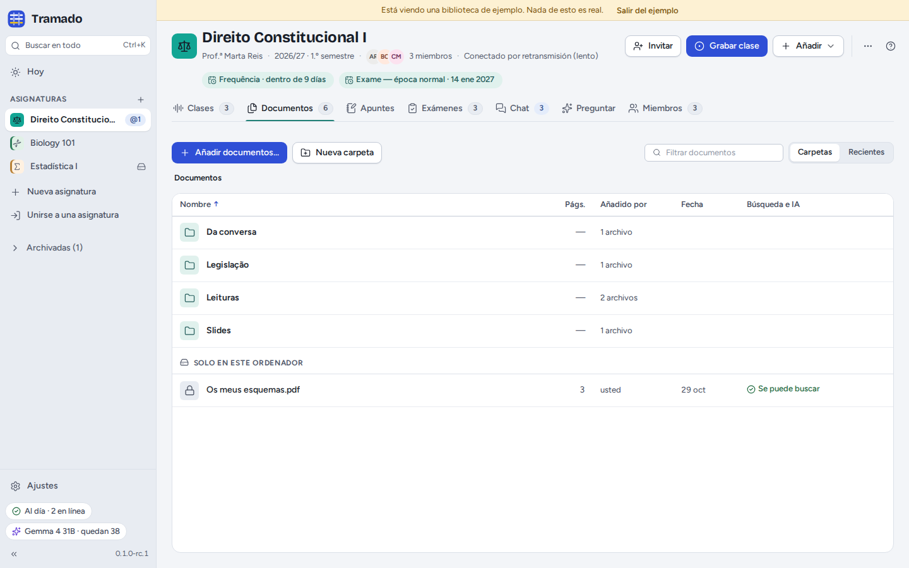
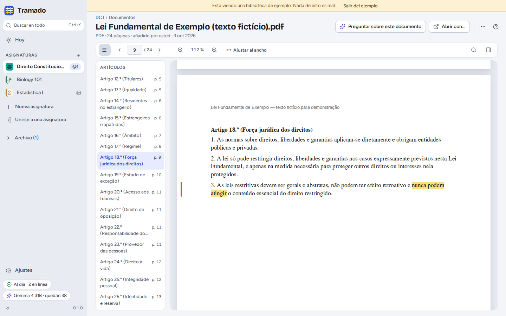
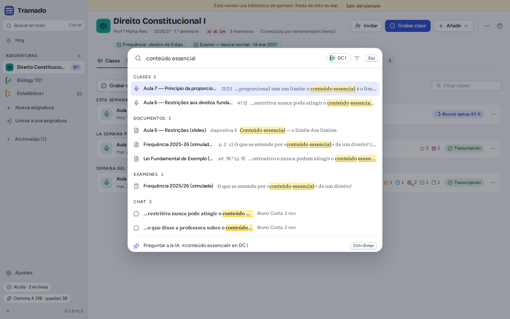

# 4. Documentos, apuntes y búsqueda

[Índice](index.md) · Anterior: [Clases](03-lectures.md) · Siguiente: [Exámenes](05-exams.md)

## Añadir documentos

Arrastre archivos a la ventana, o use **Añadir documentos…**: PDF, Word (`.docx`), PowerPoint (`.pptx`), texto
OpenDocument, RTF, HTML, Markdown, texto sin formato, subtítulos e imágenes. Tramado los copia en la carpeta de la
asignatura y lee su texto, para que la búsqueda y la IA puedan usarlo. La columna del texto muestra hasta dónde ha
llegado:

- **Se puede buscar**: listo;
- **Leyendo el texto… 40 %**: todavía trabajando (los códigos legales grandes tardan un poco);
- **Escaneo: sin texto**: el archivo es una imagen de las páginas. Con la IA configurada, **Leer el texto con IA…** (en
  el menú del archivo) lee hasta 20 páginas, con una solicitud a la IA por página.

Tramado se da cuenta cuando un compañero ya ha añadido el mismo archivo, y propone organizar los archivos de la
asignatura en carpetas (*Diapositivas*, *Lecturas*, *Legislación*, *Exámenes anteriores*). En una asignatura
compartida, el menú de un archivo tiene **Mantener privado (solo usted)…** (pasa a *Solo en este ordenador*), **Quitar
solo de este ordenador…** y **Eliminar para todos…** (se puede restaurar durante 30 días desde *Eliminados
recientemente*).

## Leer un documento

Los PDF se abren dentro de Tramado, con navegación por **página**, **zoom**, **Ajustar al ancho** y **Buscar en el
documento**. Los textos legales tienen la lista de sus **Artículos** a la izquierda. Seleccione texto y elija
**Resaltar** (los resaltados se quedan en este ordenador), **Explicar**, **Preguntar** o **Copiar con la
fuente** (*«…» — Constitución, art. 18, p. 9*). **Preguntar sobre este documento** abre Preguntar con este documento
como fuente; **Abrir con…** abre el archivo en otra aplicación. Cuando una respuesta de la IA cita un pasaje, el
documento se abre en esa página con el pasaje marcado.

## Apuntes

La pestaña **Apuntes** tiene dos tipos, los dos archivos Markdown:

- **Mis apuntes · solo usted**: solo en este ordenador;
- **Apuntes compartidos · con todos los compañeros**: en la carpeta de la asignatura, todos pueden leerlos y editarlos.

La barra de herramientas tiene negrita, cursiva, títulos, listas, listas de comprobación y enlaces, y además **enlaces a
un momento de una clase** o **a una página de un documento**, que se abren ahí mismo. El menú de unos apuntes los pasa
de un tipo a otro. Si dos personas editan los mismos apuntes compartidos a la vez, se guardan las dos versiones y
**Comparar** las muestra una al lado de la otra.

## Buscar en todo

<kbd>Ctrl</kbd>+<kbd>K</kbd> (<kbd>⌘</kbd>+<kbd>K</kbd>), o **Buscar en todo** en la barra lateral, busca a la vez en
la asignatura en la que está, o en todas: transcripciones de las clases (con el minuto), documentos (con la página o el
artículo), apuntes, preguntas de examen y mensajes del chat. <kbd>Intro</kbd> abre un resultado en el lugar donde se
encontró. La última fila, **Preguntar a la IA** (<kbd>Ctrl</kbd>+<kbd>Intro</kbd>), hace la misma pregunta a la IA sobre
sus fuentes. La búsqueda también ejecuta órdenes: escriba lo que quiere hacer (por ejemplo *ajustes*) o el nombre de una
asignatura.

La búsqueda funciona sin IA y sin internet. Las tildes y las mayúsculas no importan.
