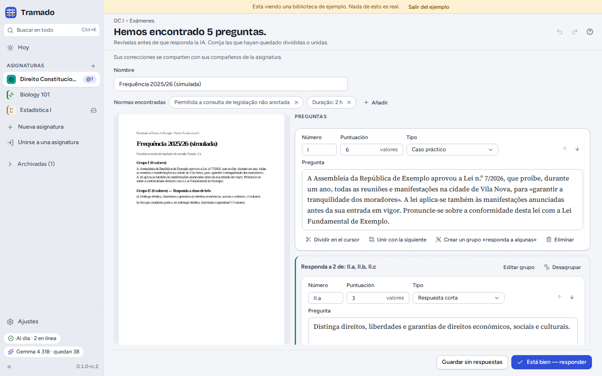
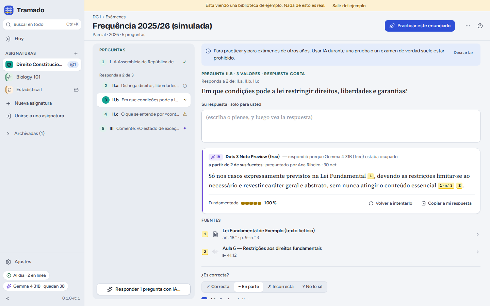
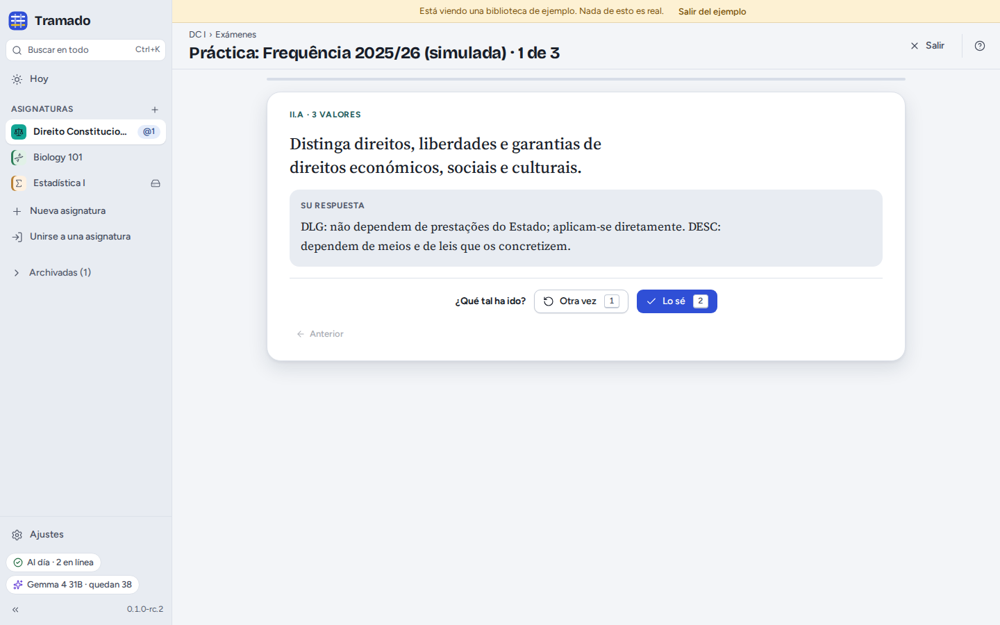

# 5. Exámenes

[Índice](index.md) · Anterior: [Documentos, apuntes y búsqueda](04-documents-notes-search.md) · Siguiente: [Grupo de la asignatura](06-class-groups.md)

La pestaña **Exámenes** guarda las fechas de las pruebas y los exámenes, y los exámenes de otros años o las preguntas
de práctica para practicar.

## Fechas de examen

**Añadir › La fecha de una prueba o un examen**: el tipo (cuestionario, prueba, parcial, examen final, examen de
recuperación, convocatoria extraordinaria…), el nombre, la fecha y la hora (deje la hora vacía para un día entero), el
aula, el temario y el peso en la nota. Tramado hace la cuenta atrás en **Hoy** y en la cabecera de la asignatura. En
una asignatura compartida, todos ven la fecha.

## Enunciados

**Añadir › Un enunciado de examen o preguntas de práctica**: arrastre un PDF, un archivo de Word o fotos del enunciado, o **Escribir
o pegar las preguntas**. **Buscar las preguntas** usa la IA: antes de empezar, Tramado dice cuántas solicitudes gastará
(una por página que leer, más una para encontrar las preguntas) y cuántas solicitudes gratuitas le quedan hoy. Sin IA,
escriba las preguntas usted mismo. Puede salir de la pantalla mientras lee; Tramado continúa.

### Revisar las preguntas

Antes de cualquier respuesta, revise lo que se ha encontrado, junto al original: el **número**, los **puntos**, el
**tipo** y el **texto** de cada pregunta. Corrija las preguntas divididas o unidas por error (**Dividir en el cursor**,
**Unir con la siguiente**), agrupe las preguntas del tipo "responda a dos de tres" (**Crear un grupo «responda a
algunas»**) y conserve o quite las **normas encontradas** (por ejemplo *se permite consultar legislación sin anotar*,
*duración: 2 h*). Después, **Está bien — responder**, o **Guardar sin respuestas**. En una asignatura compartida, sus
correcciones se comparten.

### Respuestas con fuentes

Elija cómo responde la IA (solo con los materiales de la asignatura, o también con conocimiento general, marcado como
no verificado) y si quiere **intentar responder primero a cada pregunta** (recomendado: responder antes de mirar es lo
que hace que se quede). Después, en cada pregunta:

- escriba su respuesta en **Su respuesta · solo para usted**, o piénsela;
- **Mostrar la respuesta de la IA**. Cada afirmación lleva una **cita** numerada: pase el ratón por encima para ver el
  fragmento, haga clic para abrir la página del documento, el artículo o el momento de la clase. **Fundamentada** muestra
  qué parte de la respuesta se apoya en sus fuentes; las frases que no están en sus materiales quedan señaladas;
- márquela como **Correcta**, **En parte**, **Incorrecta** o **No lo sé**, añada la respuesta correcta si la sabe y
  pulse **Añadir a la práctica**.

La tarjeta de la IA dice qué modelo respondió, y cuándo el modelo gratuito predeterminado estaba ocupado y respondió
otro. En una asignatura compartida, las respuestas de la IA se comparten, para que los compañeros no gasten sus
solicitudes en las mismas preguntas.

> Para practicar y para exámenes de otros años. Usar IA durante una prueba o un examen de verdad suele estar prohibido.

## Práctica

**Practicar este enunciado**, o **Practicar** en Hoy, muestra una pregunta cada vez. Piense o escriba su respuesta,
<kbd>Espacio</kbd> muestra la respuesta y después diga cómo le ha ido: **Otra vez** (<kbd>1</kbd>) o **Lo sé**
(<kbd>2</kbd>). Las preguntas que falló vuelven al día siguiente. Su práctica se queda en su ordenador.
