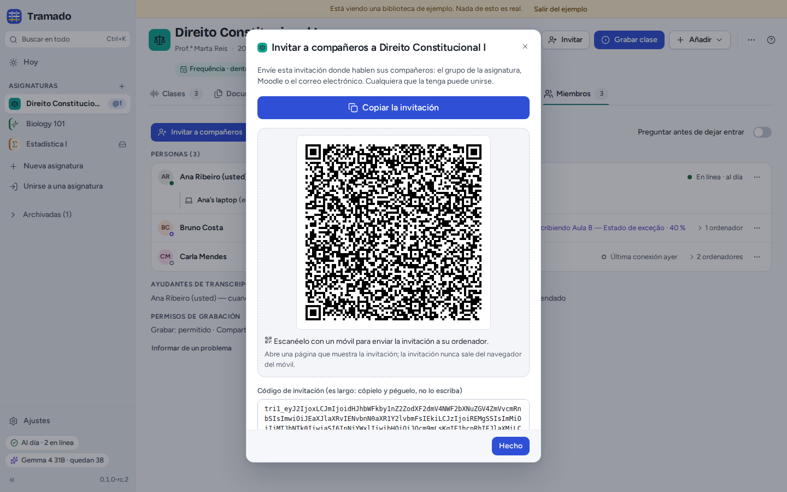
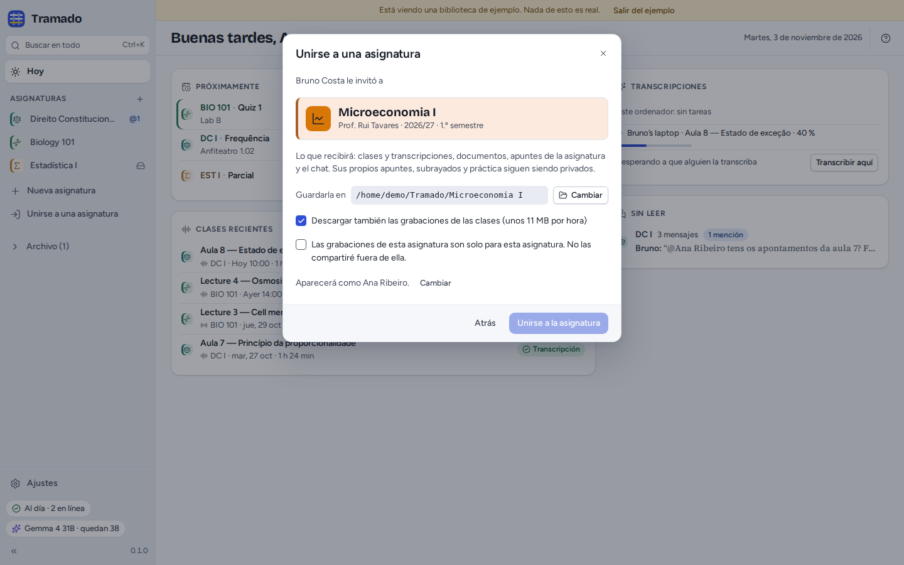
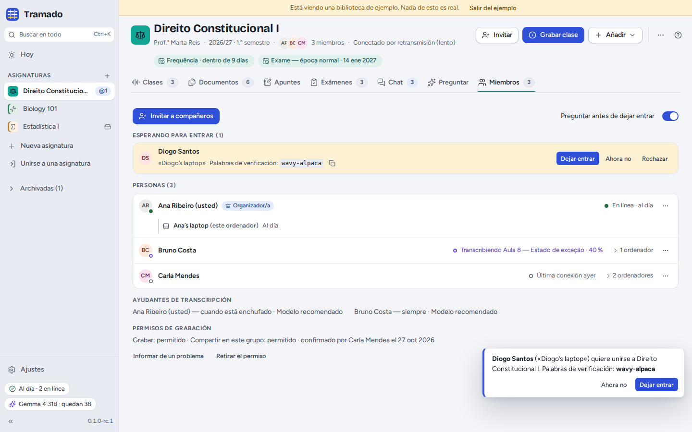
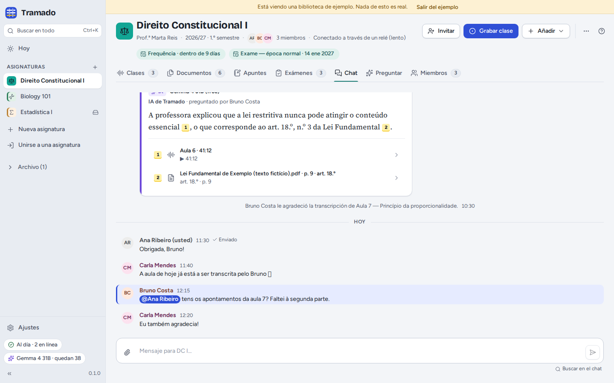
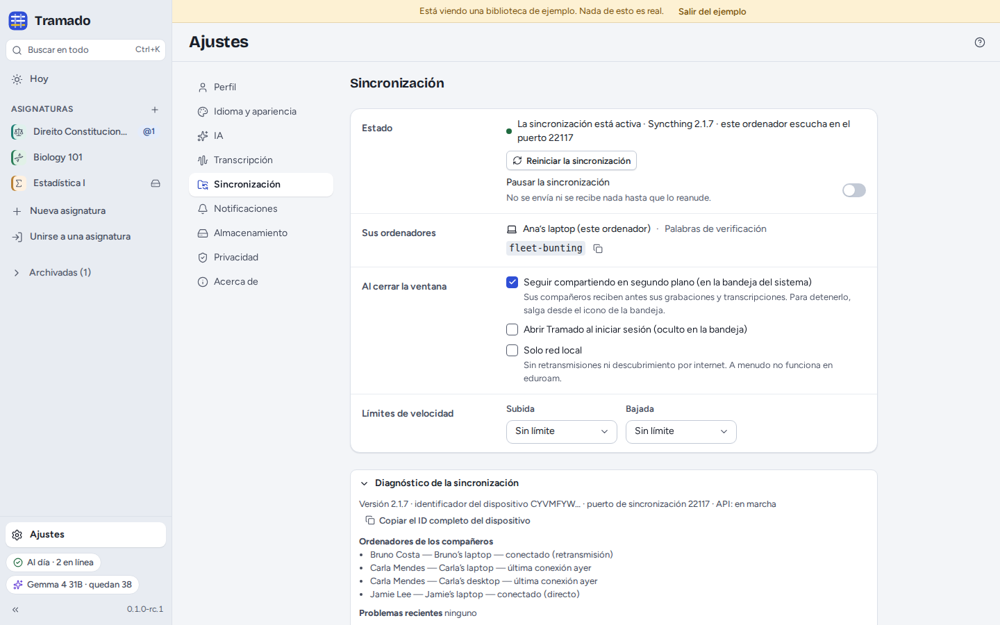

# 6. Grupo de la asignatura

[Índice](index.md) · Anterior: [Exámenes](05-exams.md) · Siguiente: [IA](07-ai.md)

Comparta una asignatura y los compañeros reciben la misma carpeta: clases y transcripciones, documentos, apuntes
compartidos, enunciados y respuestas de la IA compartidas, y un chat del grupo. Sus apuntes, resaltados, práctica y
conversaciones de Preguntar nunca forman parte de ella.

No hay ningún servidor de Tramado. La sincronización usa [Syncthing](https://syncthing.net), que viene dentro de
Tramado: los archivos viajan cifrados, directamente entre los ordenadores de los compañeros, siempre que dos de ellos
estén en línea a la vez. Para encontrarse en redes distintas, los ordenadores usan los servidores públicos de
descubrimiento y de retransmisión de Syncthing; véase [Ajustes y privacidad](08-settings-and-privacy.md).

## Compartir una asignatura

Active **Compartir con los compañeros** al crear una asignatura, o más tarde use la pestaña **Compartir** de la
asignatura (o **⋯ › Compartir esta asignatura…**). La primera vez, Tramado pregunta si quiere **seguir compartiendo en
segundo plano** al cerrar la ventana: así los compañeros reciben antes sus grabaciones y transcripciones. Puede
cambiarlo en Ajustes › Sincronización.

## Invitar a compañeros

**Invitar** (en la cabecera de la asignatura o en Miembros) muestra la invitación:

- **Copiar la invitación** copia un mensaje corto con un enlace y el código: péguelo en el grupo de la asignatura, en
  Moodle o en un correo. El enlace abre en el navegador la página de Tramado para unirse
  (`https://feiteira.github.io/Tramado/join/`);
- el **código QR** abre la misma página en el móvil que lo escanee;
- **Copiar el código** copia solo el código, y **Guardar como archivo…** guarda un archivo `.tramado-invite`, que se
  abre desde **Unirse a una asignatura › Abrir un archivo de invitación…**.

La página para unirse muestra la asignatura y quién envió la invitación. En un ordenador con Tramado, **Abrir en
Tramado** abre la invitación en **Unirse a una asignatura**; en un móvil, pulse **Copiar el código**, envíe el código a
su ordenador (por correo, o por una aplicación de mensajería que también use en el ordenador) y péguelo en **Unirse a
una asignatura**. La invitación va en la parte del enlace que sigue a `#`, que el navegador nunca envía a un servidor:
la página la lee en su dispositivo y no envía nada a ningún sitio.

Quien tenga la invitación puede entrar, a través de su ordenador o del de cualquier miembro que esté en línea; si no
hay nadie, espera. Para aprobar a cada persona primero, un organizador activa **Preguntar antes de dejar entrar** en
Miembros.

## Unirse a una asignatura

**Unirse a una asignatura** (en la barra lateral, o <kbd>Ctrl</kbd>+<kbd>Mayús</kbd>+<kbd>J</kbd>): pegue la invitación
(sirve el mensaje entero) o abra un archivo de invitación, y pulse **Continuar**. (Un enlace abre primero la página
para unirse: allí, **Abrir en Tramado** abre esta ventana con la invitación ya puesta.) Tramado muestra la asignatura y
quién le ha invitado. Elija dónde guardarla, si quiere **descargar también las grabaciones de las clases** (unos 11 MB
por hora; recibe todas las transcripciones en cualquier caso) y acepte que las grabaciones de esta asignatura son solo
para ella. Después, **Unirse a la asignatura**.

Tramado muestra sus **palabras de verificación** (por ejemplo *wavy-alpaca*). Si la asignatura pregunta antes de dejar
entrar, un miembro ve las mismas palabras junto a su nombre: dígalas en voz alta o en el grupo, para que sepan que es
usted. Puede cerrar la ventana mientras espera; Tramado le avisa cuando haya entrado, y los archivos empiezan a llegar.

## Miembros

La pestaña **Miembros** muestra:

- **Esperando para entrar** (cuando la asignatura pregunta primero): **Dejar entrar**, **Ahora no** o **Rechazar**.
  Compare antes las palabras de verificación.
- **Personas**, con quién está en línea, qué está haciendo (por ejemplo transcribiendo una clase) y sus ordenadores.
  Los organizadores pueden **Hacer organizador/a** y **Quitar de la asignatura…**: el Tramado de todos deja de compartir
  la asignatura con los ordenadores de esa persona (conserva lo que ya tiene), y a partir de entonces quien llegue
  tiene que ser aprobado.
- **Ayudantes de transcripción**: quién transcribe automáticamente las clases de la asignatura, y con qué modelo.
- **Permisos de grabación**: el permiso del profesor registrado, quién lo confirmó y cuándo; **Retirar el permiso**
  impide que se compartan las nuevas grabaciones.

Si la asignatura se queda sin organizadores (se han ido todos), cualquier miembro puede pulsar **Ser organizador/a**.

## El chat del grupo

Escriba al grupo en **Chat**. Responda a un mensaje, mencione a alguien con **@**, o pregunte a **@IA**: Tramado
responde a partir de las clases y los documentos de la asignatura, con su propia clave de IA, citando las fuentes, y
todos ven la respuesta (las claves de los compañeros nunca se comparten). Los archivos que adjunte se guardan también en
**Documentos › Del chat**. Un mensaje muestra **✓ Enviado** cuando al menos el ordenador de un compañero lo tiene;
hasta entonces, se queda guardado esperando.

## Sincronización y problemas

El indicador de **sincronización**, en la parte inferior de la barra lateral, dice cómo va: *Al día · 2 en línea*,
*Sincronizando 3 archivos*, *Esperando a los compañeros* (no hay nadie en línea: los cambios se guardan y se
sincronizarán más tarde), *Uso compartido en pausa* o *El uso compartido no está funcionando*. Haga clic en él para ver
los detalles. En eduroam y otras redes universitarias, los ordenadores muchas veces no pueden conectarse directamente;
pasan entonces por una retransmisión, que es más lenta (la cabecera de la asignatura lo indica).

Cuando dos personas cambian el mismo archivo a la vez, se guardan las dos versiones (la otra queda marcada como *Copia
en conflicto*). En **⋯ › Eliminados recientemente…** de una asignatura se pueden restaurar los archivos eliminados
durante 30 días.

## Ajustes › Sincronización

- **Estado**: si la sincronización está funcionando, con **Reiniciar la sincronización** y **Pausar la
  sincronización**.
- **Sus ordenadores**: este ordenador y sus palabras de verificación. (Añadir un segundo ordenador suyo está previsto
  para una versión posterior.)
- **Al cerrar la ventana**: seguir compartiendo en segundo plano (en la bandeja del sistema) y abrir Tramado al iniciar
  sesión.
- **Solo red local**: sin retransmisiones ni descubrimiento por internet (muchas veces no funciona en eduroam).
- **Límites de velocidad** de subida y de bajada.
- **Diagnóstico de la sincronización**: versión, puertos, los ordenadores de los compañeros y cómo se conectan,
  problemas recientes y el registro, para copiarlo en un informe de error.
