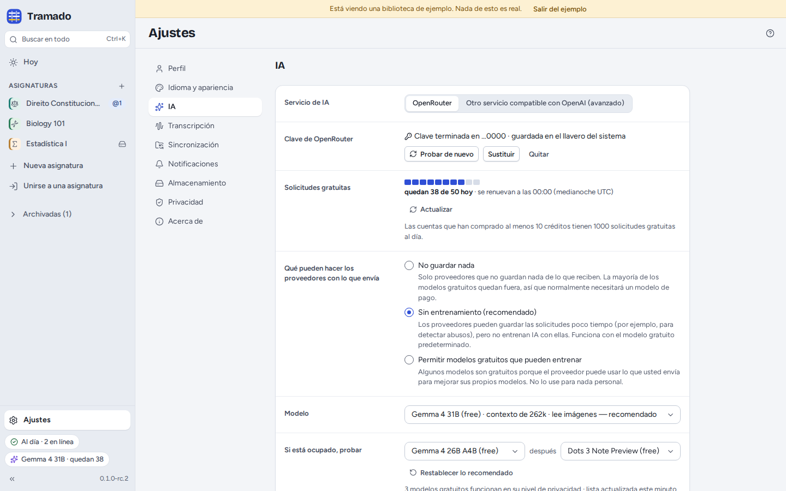
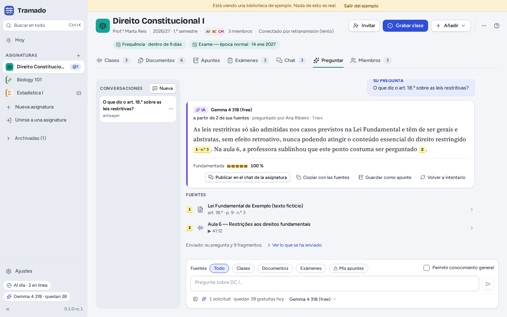

# 7. IA

[Índice](index.md) · Anterior: [Grupo de la asignatura](06-class-groups.md) · Siguiente: [Ajustes y privacidad](08-settings-and-privacy.md)

La IA es opcional. Sin ella puede seguir grabando, transcribiendo, buscando, tomando apuntes, compartiendo y
practicando; los botones de IA simplemente se ocultan. Con ella, Tramado responde a preguntas de examen, explica
fragmentos, resume clases, lee páginas escaneadas y responde a preguntas sobre sus asignaturas, siempre **a partir de los
materiales de la asignatura, con citas**.

## Configurarla

Tramado usa [OpenRouter](https://openrouter.ai), un servicio que da acceso a muchos modelos de IA con una sola clave.
Usted usa **su propia clave**, y los modelos gratuitos funcionan:

1. Cree una clave gratuita en [openrouter.ai/keys](https://openrouter.ai/keys).
2. Péguela en Ajustes › IA (o en el paso del primer inicio) y pulse **Probar y guardar**.

> OpenRouter es para mayores de **18 años**. Si es menor, no lo use: omita la IA, o conecte otro servicio (véase
> [más abajo](#otro-servicio-ia-local)).

La clave se guarda en el llavero del sistema (o, si no lo hay, en un archivo privado que solo usted puede leer) y nunca
llega a la ventana de la aplicación: es el propio Tramado quien la añade a cada solicitud.

### Solicitudes gratuitas

Los modelos gratuitos no cuestan nada, pero tienen límites: 50 solicitudes al día en las cuentas que nunca han comprado
crédito, 1000 al día después de comprar al menos 10 créditos, y unas 20 por minuto. Ajustes › IA y el indicador de la
IA muestran cuántas quedan hoy (el recuento se reinicia a medianoche UTC). Antes de algo que gaste varias solicitudes
(leer un examen escaneado, responder a un enunciado entero), Tramado dice cuántas va a usar.

### El modelo

El modelo predeterminado es **Gemma 4 31B (free)** (`google/gemma-4-31b-it:free`). **Si está ocupado, probar** indica
otros dos modelos gratuitos que Tramado prueba a continuación; **Restablecer lo recomendado** vuelve a los valores recomendados. Cada
respuesta dice qué modelo la escribió.

Los modelos gratuitos suelen estar ocupados. Cuando lo están todos, Tramado avisa y propone reintentar, **Usar los
modelos gratuitos de NVIDIA en esta solicitud** o **Cambiar de modelo**. Los modelos gratuitos de NVIDIA pueden usar lo
que envía para entrenar su IA, así que Tramado nunca pasa a ellos sin preguntar, salvo que elija **Usarlos siempre que
estén ocupados**.

### Qué pueden hacer los proveedores con lo que envía

| Nivel | Significado |
|---|---|
| **No guardar nada** | Solo proveedores que no guardan nada de lo que reciben. La mayoría de los modelos gratuitos quedan fuera: normalmente necesitará un modelo de pago. |
| **Sin entrenamiento (recomendado)** | Los proveedores pueden guardar las solicitudes poco tiempo (por ejemplo, para detectar abusos), pero no entrenan IA con ellas. Funciona con el modelo gratuito predeterminado. |
| **Permitir modelos gratuitos que pueden entrenar** | Algunos modelos gratuitos son gratuitos porque el proveedor puede usar lo que envía para mejorar su IA. No use esta opción para nada personal. |

Hacer el nivel menos estricto siempre pide su confirmación en una ventana aparte.

## Qué recibe la IA

Solo lo que necesita cada pregunta: su pregunta y los **fragmentos** de sus fuentes que la responden (con los nombres de
los archivos y las páginas o los tiempos). Nunca una carpeta entera, nunca sus apuntes privados salvo que incluya *Mis
apuntes*, nunca el historial del chat ni otras asignaturas. Debajo de cada respuesta, **Ver lo que se ha enviado** muestra
exactamente lo que salió. Ajustes › Privacidad guarda un registro de todas las solicitudes hechas desde este ordenador.

## Preguntar

La pestaña **Preguntar** de una asignatura (o **Preguntar a la IA** en todas las asignaturas, desde la búsqueda) es una
conversación sobre sus materiales. Elija las **Fuentes** (todas, clases, documentos, exámenes, o *Mis apuntes*) y si
quiere **Permitir conocimiento general** (las frases que no estén en sus materiales se marcan entonces como no
verificadas). Las respuestas llevan citas y un porcentaje **Fundamentada**. Desde una respuesta puede **Publicar en el
chat de la asignatura**, **Copiar con las fuentes**, **Guardar como apunte** o volver a intentarlo. Las conversaciones se
quedan en este ordenador.

La IA está también en otros sitios: **Explicar** en el texto seleccionado, la pestaña **IA** de una clase, **Preguntar a
la IA** en la búsqueda, **@IA** en el chat y las respuestas a exámenes ([Exámenes](05-exams.md)).

## Otro servicio (IA local)

**Ajustes › IA › Otro servicio compatible con OpenAI (avanzado)** conecta cualquier servicio que hable la API de OpenAI:
[Ollama](https://ollama.com) o [LM Studio](https://lmstudio.ai) en su ordenador, o un servidor de su universidad.
Indique la **Dirección**, una **Clave** si hace falta y el **Modelo**, y pulse **Probar**. El `http` sin cifrar solo
funciona para su ordenador y su red local; Tramado le pide que confirme cada dirección nueva en una ventana aparte. Lo
que el servicio haga con sus datos depende de quién lo gestione.

## Desactivar la IA

**Desactivar la IA en este ordenador** (Ajustes › IA) oculta todos los botones de IA; la clave sigue guardada.
