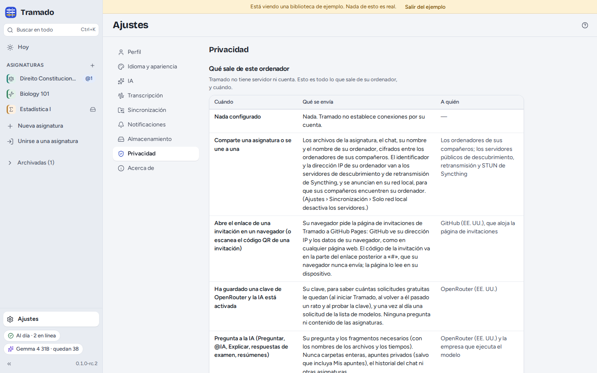

# 8. Ajustes y privacidad

[Índice](index.md) · Anterior: [IA](07-ai.md)

Los **Ajustes** están en la parte inferior de la barra lateral (<kbd>Ctrl</kbd>+<kbd>,</kbd>).

## Las secciones

- **Perfil**: su nombre (los compañeros lo ven en todas las asignaturas que comparte), el nombre de este ordenador y su
  color. Los compañeros ven su nombre y los nombres de sus ordenadores, nunca un número de teléfono ni un correo.
- **Idioma y apariencia**: English, Português (Portugal) o Español (España); tema claro, oscuro o el del sistema;
  tamaño del texto; el tipo de letra (el predeterminado, *Atkinson Hyperlegible Next*, más fácil de leer, u
  *OpenDyslexic*); reducir el movimiento.
- **IA**: la clave, el nivel de privacidad, el modelo y sus alternativas, el idioma de las respuestas, otro servicio y
  desactivar la IA. Véase [IA](07-ai.md).
- **Transcripción**: modelos de voz, ayudar al grupo a transcribir, transcripción en la nube, el micrófono y su prueba,
  la calidad de la grabación (*Estándar*, unos 11 MB por hora, o *Ahorro de espacio*, unos 7 MB por hora), cuánto
  retroceden los marcadores y los atajos de los marcadores que funcionan desde cualquier aplicación. Véase
  [Clases](03-lectures.md#transcripción).
- **Compartir**: véase [Grupos de clase](06-class-groups.md#ajustes--compartir).
- **Notificaciones**: notificaciones del sistema, y de qué quiere enterarse (una transcripción que espera, alguien que
  entra, una fecha de examen añadida o cambiada, un modelo de voz descargado). Cada asignatura puede cambiarlo en su
  menú **⋯ › Notificaciones**.
- **Almacenamiento**: dónde se crean las nuevas asignaturas; el tamaño de cada asignatura (grabaciones, y archivos
  eliminados guardados durante 30 días) con **Vaciar la papelera de la asignatura** y **Sin audio**; los modelos de
  voz; la caché (texto para buscar, índices), que se reconstruye sola; y si quiere quitar las grabaciones que hizo una
  vez transcritas (nunca, a los 30 o a los 90 días; la transcripción se queda).
- **Privacidad**: véase abajo.
- **Acerca de**: la versión, la licencia y el código fuente; **Atajos de teclado**; **Copiar diagnóstico** (no se envía
  nada); **Probar la reproducción de audio**; las licencias del software que incluye Tramado.

## Qué sale de su ordenador

Tramado no tiene servidor ni cuenta. Ajustes › Privacidad enumera todo lo que sale alguna vez de su ordenador, y
cuándo. La misma tabla está en el repositorio en [PRIVACY.es.md](../../../PRIVACY.es.md) ([English](../../../PRIVACY.md)
· [Português](../../../PRIVACY.pt.md)). En resumen:

- **Nada**, hasta que comparta una asignatura, active la IA o descargue un modelo de voz. Sin telemetría, sin
  estadísticas de uso, sin informes de errores; las estadísticas de uso de Syncthing están desactivadas.
- **Compartir una asignatura** envía los archivos de la asignatura, el chat, su nombre y el nombre de su ordenador,
  cifrados, a los ordenadores de los compañeros. El identificador y la dirección IP de su ordenador van a los
  servidores de descubrimiento y de retransmisión de Syncthing y se anuncian en la red local, para que los compañeros
  le encuentren (*Solo red local* desactiva los servidores).
- **La IA** envía su pregunta y los pasajes que necesita a OpenRouter y a la empresa que gestiona el modelo (o al
  servicio que haya configurado). Con una clave guardada y la IA activada, Tramado también comprueba cuántas
  solicitudes gratuitas quedan y, una vez al día, obtiene la lista de modelos.
- **Transcribir con OpenRouter** envía la grabación en fragmentos de hasta 30 segundos; **leer un escaneo con IA** envía
  las imágenes de las páginas.
- **Descargar un modelo de voz** envía una solicitud de descarga a Hugging Face.

La **Actividad de la IA en este ordenador** es un registro privado de todas las solicitudes a la IA hechas desde aquí
(hora, asignatura, acción, modelo, pasajes enviados). Nunca se envía a ningún sitio; **Vaciar el registro** lo borra.

## Dónde están sus archivos

- **Sus asignaturas** son carpetas normales, por defecto en `Tramado`, dentro de su carpeta personal (Ajustes ›
  Almacenamiento cambia dónde se crean las nuevas).
- **Los datos privados de Tramado** (sus apuntes, resaltados, práctica, conversaciones de Preguntar y el registro de
  actividad de la IA), los modelos de voz y la caché están en las carpetas propias de Tramado, en este ordenador, y
  nunca se comparten. En Linux son `~/.local/share/eu.thehumanloop.tramado`, `~/.config/eu.thehumanloop.tramado` y
  `~/.cache/eu.thehumanloop.tramado`. Ajustes › Privacidad › *Dónde están sus datos* abre cada una.
- **Su clave de OpenRouter** está en el llavero del sistema, o en un archivo privado en la carpeta de ajustes de Tramado
  cuando no hay llavero.
