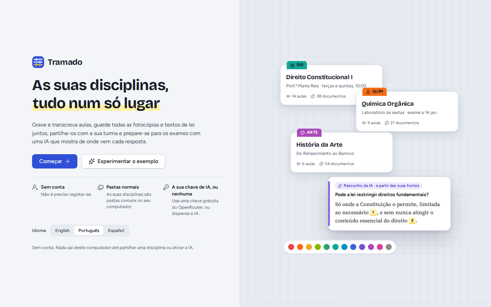
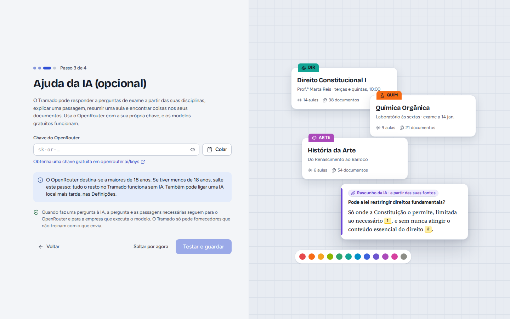
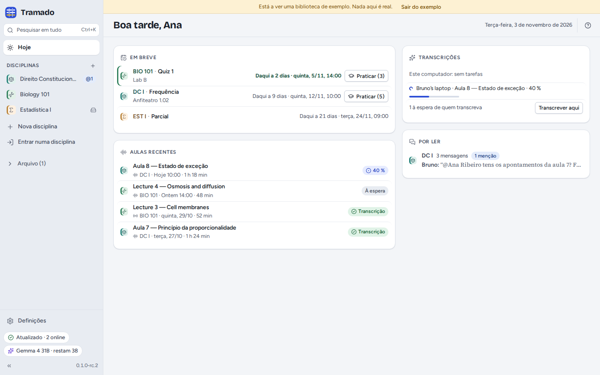

# 1. Primeiros passos

[Índice](index.md) · Seguinte: [Disciplinas](02-classes.md)

## Instalar

- **Linux**: o `.AppImage` funciona na maioria das distribuições (torne-o executável e abra-o); o `.deb` é para Debian e
  Ubuntu. Ambos incluem o Tramado, o programa Syncthing, que partilha as disciplinas, e o pequeno modelo que encontra a
  fala nas gravações.
- **Windows e macOS**: os instaladores são gerados automaticamente, mas ainda não foram testados. Não têm assinatura de
  código: o SmartScreen do Windows pede confirmação (*Mais informações › Executar mesmo assim*); no macOS, abra a
  aplicação uma vez e depois *Definições do Sistema › Privacidade e Segurança › Abrir mesmo assim*.

O modelo de voz que transcreve as aulas não vem no instalador: o Tramado transfere-o da primeira vez que transcrever
(ver [Aulas](03-lectures.md#transcrição)).

## O primeiro arranque

Escolha o idioma em baixo e depois **Começar**. (**Experimentar o exemplo** abre uma biblioteca de disciplinas
fictícias: ver [mais abaixo](#a-biblioteca-de-exemplo).) Seguem-se três passos curtos:

1. **O seu nome**, tal como os colegas o verão junto às suas mensagens e gravações, e o nome deste computador. A linha
   por baixo diz onde ficam as disciplinas (uma pasta chamada `Tramado` na sua pasta pessoal); **Alterar…** escolhe
   outro sítio. Evite uma pasta que o Dropbox, o OneDrive ou o Google Drive já sincronizem: o Tramado avisa se escolher
   uma.
2. **Ajuda da IA (opcional).** Cole uma chave do OpenRouter e carregue em **Testar e guardar**, ou em **Saltar por
   agora**. Tudo funciona sem ela, exceto as funções de IA. O OpenRouter é para maiores de 18 anos; se for mais novo,
   salte este passo (pode ligar um serviço de IA local mais tarde). Ver [IA](07-ai.md).
3. **Está tudo pronto**: crie a primeira disciplina, ou entre numa com o convite que um colega lhe enviou.

## O ecrã Hoje

**Hoje** reúne o que precisa de si agora:

- **Em breve**: os testes e exames das próximas semanas, com contagem decrescente e **Praticar** nas disciplinas com
  perguntas para treinar.
- **Transcrições**: o que este computador e os dos colegas estão a transcrever, e as aulas à espera de quem as
  transcreva (**Transcrever aqui**).
- **Aulas recentes** e as mensagens e menções **Por ler** nas conversas das suas disciplinas.

À esquerda, a **barra lateral**: **Pesquisar em tudo** (<kbd>Ctrl</kbd>+<kbd>K</kbd>), **Hoje**, as suas
**disciplinas** (<kbd>Ctrl</kbd>+<kbd>1</kbd>…<kbd>9</kbd> abre-as), **Nova disciplina**, **Entrar numa disciplina**,
o **Arquivo** e as **Definições**. Em baixo, dois indicadores de estado:

- o da **partilha** (por exemplo *Atualizado · 2 online*, *A sincronizar 3 ficheiros*, *À espera dos colegas*): clique
  nele para ver detalhes e problemas;
- o da **IA**, com o seu modelo e os pedidos gratuitos que restam hoje.

## A biblioteca de exemplo

**Experimentar o exemplo**, no ecrã de boas-vindas, abre uma biblioteca de disciplinas fictícias (Direito
Constitucional em português, Biologia em inglês, Estatística em espanhol) com aulas, documentos, exames e conversa da
turma, para experimentar tudo sem gravar nem partilhar nada. Uma faixa amarela lembra que nada daquilo é real; **Sair
do exemplo** volta à sua biblioteca (ao ecrã de boas-vindas, se ainda não configurou o Tramado). Nada do que fizer no
exemplo é guardado.

## Ajuda

<kbd>F1</kbd> ou <kbd>?</kbd> mostra os atalhos de teclado; entre eles, <kbd>Ctrl</kbd>+<kbd>Shift</kbd>+<kbd>R</kbd>
começa ou termina uma gravação e <kbd>Ctrl</kbd>+<kbd>,</kbd> abre as Definições (<kbd>⌘</kbd> em vez de
<kbd>Ctrl</kbd> num Mac). Em Definições › Acerca há **Copiar diagnóstico** (um resumo para comunicar um erro, sem nada
do conteúdo das suas disciplinas; nada é enviado) e **Testar a reprodução de áudio**.
