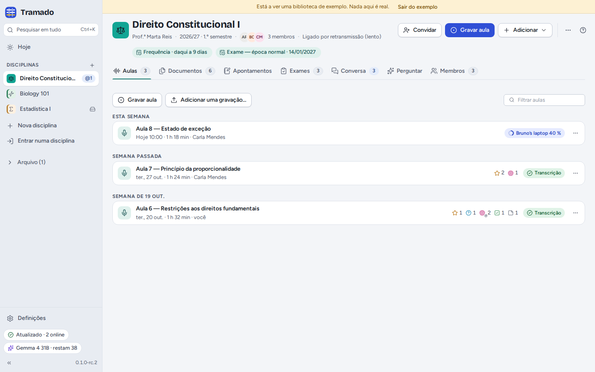
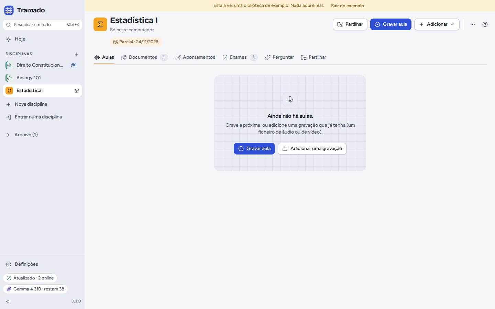

# 2. Disciplinas

[Índice](index.md) · Anterior: [Primeiros passos](01-getting-started.md) · Seguinte: [Aulas](03-lectures.md)

Uma **disciplina** é uma cadeira que está a frequentar. Tudo o que lhe diz respeito fica numa pasta normal do seu
computador, que pode abrir, copiar ou guardar numa cópia de segurança como qualquer outra.

## Criar uma disciplina

**Nova disciplina**, na barra lateral (ou <kbd>+</kbd> junto a *Disciplinas*), abre um pequeno formulário:

- **Nome** (por exemplo *Teoria Geral do Direito Civil*) e um **Nome curto** para a conversa, as notificações e os
  espaços apertados;
- **Cor** e **Ícone**, para reconhecer a disciplina em todo o lado;
- **Docente** e **Período** (opcionais);
- **Língua falada nas aulas**, usada nas transcrições e nas respostas da IA (ou *Detetar automaticamente*);
- **Partilhar com os colegas**: ligado, os colegas que convidar recebem as aulas, os documentos, os apontamentos da
  turma e a conversa; desligado, a disciplina fica só neste computador, e pode partilhá-la mais tarde (ver
  [Turmas](06-class-groups.md));
- **Vocabulário para as transcrições**: nomes e termos que o docente usa (por exemplo *Gomes Canotilho, quid iuris*),
  para que o modelo de voz os escreva bem.

## O ecrã da disciplina

O cabeçalho mostra o nome da disciplina, o docente e o período, os membros, as próximas datas de exames e o estado da
sincronização. Os botões:

- **Convidar** (disciplinas partilhadas) ou **Partilhar** (disciplinas só neste computador);
- **Gravar aula**;
- **Adicionar**: documentos, uma gravação, uma data de exame, um enunciado, apontamentos seus ou da turma;
- **⋯**: **Definições da disciplina…** (o mesmo formulário, mais *Perguntar antes de deixar entrar* e *Não guardar os
  ficheiros de áudio neste computador* nas disciplinas partilhadas), **Notificações**, **Eliminados recentemente…**,
  **Abrir a pasta**, **Arquivar**, **Sair da disciplina…** e **Eliminar a disciplina…**.

Os separadores: **Aulas**, **Documentos**, **Apontamentos**, **Exames**, **Conversa**, **Perguntar** e **Membros** (uma
disciplina só neste computador tem **Partilhar** em vez de Conversa e Membros).

## A pasta da disciplina

A pasta de uma disciplina tem `Aulas`, `Documentos`, `Exames` e `Notas` (com os nomes no idioma de quem criou a
disciplina: `Lectures`, `Documents`, `Exams`, `Notes` em inglês; `Clases`, `Documentos`, `Exámenes`, `Notas` em
espanhol), e uma pasta oculta `.tramado` com os registos da própria disciplina (membros, conversa, pedidos de
transcrição, correções…). Cada aula é uma pasta com a gravação (`audio.webm`) e a transcrição (`transcript.md`,
`transcript.vtt`). Pode mudar o nome destas pastas no gestor de ficheiros: o Tramado encontra os seus ficheiros pelo
conteúdo, não pelo nome. Não mexa na `.tramado`.

O que é seu **não** está na pasta da disciplina: os seus apontamentos e destaques, o seu treino, as suas conversas com
a IA e o registo de atividade da IA ficam nos dados do próprio Tramado, neste computador. Só chegam aos colegas se
passar uns apontamentos para a turma ou publicar uma resposta na conversa.

## Eliminados recentemente

Numa disciplina partilhada, os ficheiros que eliminar, ou que um colega eliminar, podem ser repostos para todos durante
30 dias em **⋯ › Eliminados recentemente…**. Se desaparecerem muitos ficheiros de uma vez da pasta de uma disciplina
partilhada, fora do Tramado (mais de 20 em 10 segundos), a partilha dessa disciplina fica em pausa e o Tramado pergunta
se era isso que queria antes de mexer nas cópias dos colegas.

## Arquivar, sair, eliminar

- **Arquivar** passa uma disciplina que já não acompanha para o **Arquivo** da barra lateral, completa;
  **Desarquivar** trá-la de volta.
- **Sair da disciplina…** (disciplinas partilhadas) deixa de receber atualizações. A sua cópia fica neste computador, a
  não ser que marque *Eliminar também a minha cópia deste computador*. O que adicionou fica com os colegas: remova-o
  antes de sair se quiser que desapareça.
- **Eliminar a disciplina…** apaga a pasta e tudo o que lá está deste computador, depois de escrever o nome da
  disciplina. Não pode ser desfeito.
