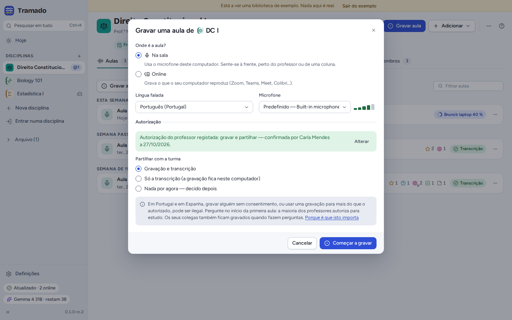
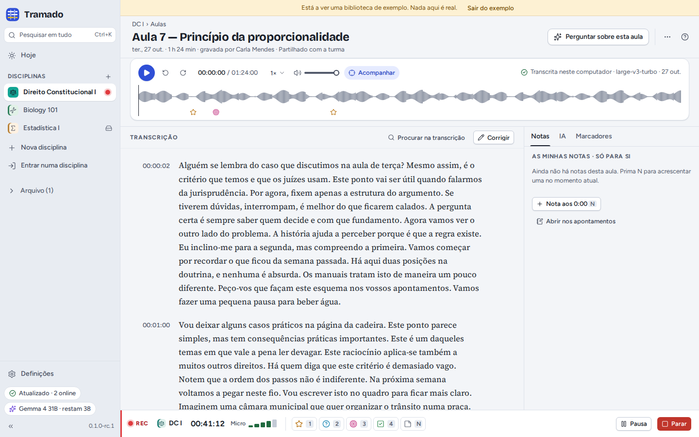
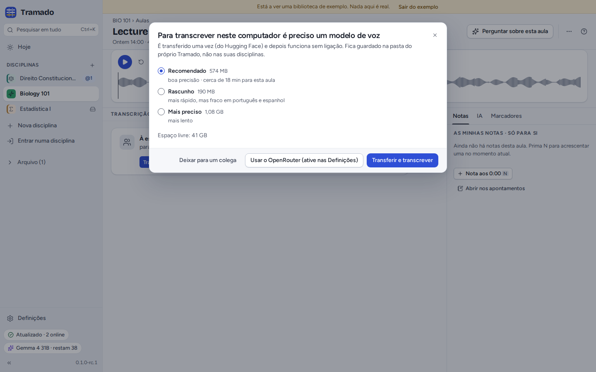
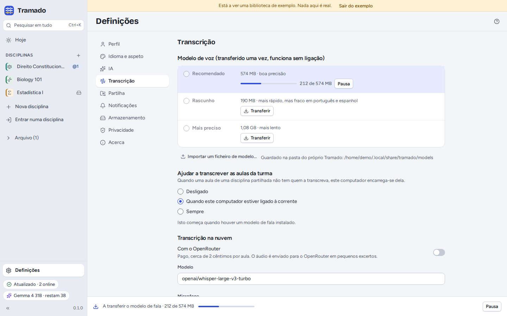
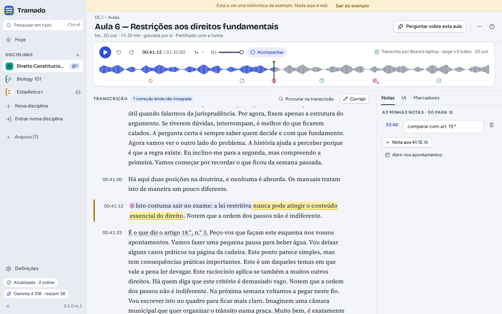
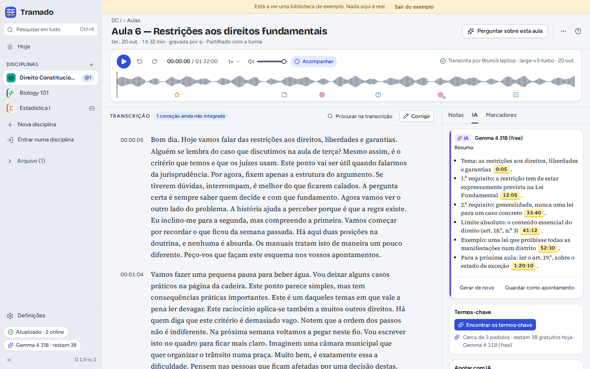

# 3. Aulas

[Índice](index.md) · Anterior: [Disciplinas](02-classes.md) · Seguinte: [Documentos, apontamentos e pesquisa](04-documents-notes-search.md)

## Gravar uma aula

**Gravar aula** (numa disciplina, ou <kbd>Ctrl</kbd>+<kbd>Shift</kbd>+<kbd>R</kbd>) abre a janela de gravação, que se
lembra das suas respostas para cada disciplina.

- **Onde é a aula?** *Na sala* usa o microfone deste computador: sente-se à frente, perto do docente ou de uma coluna.
  *Online* grava o que o computador reproduz (Zoom, Teams, Meet…); use auscultadores e marque *Gravar também a minha
  voz* se quiser que as suas perguntas fiquem na gravação.
- **Língua falada** e **Microfone** (o medidor mostra o que está a ouvir).
- **Autorização.** Confirme que o docente autorizou a gravação. Em Portugal e em Espanha, gravar alguém sem
  consentimento, ou usar uma gravação para mais do que foi autorizado, pode ser ilegal: pergunte no início da primeira
  aula; a maioria dos docentes aceita, para estudo. Com *Lembrar para esta disciplina*, a autorização fica registada na
  disciplina, visível para todos em Membros.
- **Partilhar com a turma**: *Gravação e transcrição*, *Só a transcrição* (a gravação fica neste computador) ou *Nada
  por agora — decido depois*.

Se um colega já estiver a gravar a mesma aula, o Tramado avisa: só uma gravação é transcrita para a turma, mas pode
gravar na mesma, como cópia de reserva.

## Durante a gravação

A barra de gravação fica no fundo de todos os ecrãs. Marque os momentos à medida que acontecem: <kbd>1</kbd>
**Importante**, <kbd>2</kbd> **Não percebi**, <kbd>3</kbd> **Exame!**, <kbd>4</kbd> **A fazer**, e <kbd>N</kbd> para
escrever uma nota no momento atual. Os marcadores recuam alguns segundos, porque quase toda a gente carrega logo a
seguir à frase importante (pode mudar quanto em Definições › Transcrição). Se ligar os atalhos dos marcadores em
Definições › Transcrição, <kbd>Ctrl</kbd>+<kbd>Alt</kbd>+<kbd>1</kbd>…<kbd>4</kbd> também marcam a partir de qualquer
outra aplicação, durante a gravação.

A barra avisa quando o microfone não ouve nada, a bateria está a acabar ou o disco está a ficar cheio. **Pausa** e
**Parar** estão à direita. Se o computador ou o Tramado pararem a meio, a gravação não se perde: no arranque seguinte o
Tramado propõe manter o que foi gravado.

**Parar** abre **Guardar aula**: dê-lhe um título, escolha quem a transcreve (este computador, o computador de um
colega, ou o OpenRouter, se tiver ligado a transcrição na nuvem) e carregue em **Guardar**.

## Adicionar uma gravação que já tem

**Adicionar › Adicionar uma gravação…** aceita um ficheiro de áudio ou vídeo (MP3, M4A do Zoom ou do Teams, MP4, OGG,
WAV, FLAC, WebM…). O Tramado guarda só o som, comprimido para voz, a não ser que escolha manter também o vídeo. Numa
disciplina partilhada, confirme que pode partilhar a gravação com a turma.

## Transcrição

As aulas são transcritas **no seu computador**, com um modelo de voz que só é transferido uma vez:

| Modelo | Tamanho | |
|---|---|---|
| Recomendado | 574 MB | boa precisão |
| Rascunho | 190 MB | mais rápido, mas fraco em português e espanhol |
| Mais preciso | 1,08 GB | mais lento |

O modelo vem do Hugging Face, é verificado antes de ser usado e fica na pasta do próprio Tramado, não nas suas
disciplinas. A partir daí, a transcrição funciona sem ligação à internet. O Tramado indica quanto tempo, mais ou menos,
uma aula vai demorar neste computador; pode continuar a trabalhar entretanto, e o progresso aparece no fundo da janela
e em Hoje. Para uma sala sem internet, Definições › Transcrição › **Importar um ficheiro de modelo…** aceita um modelo
copiado de um colega.

**Numa disciplina partilhada, cada aula é transcrita por um único computador**, e todos recebem a mesma transcrição. Os
colegas cujos computadores ajudam a transcrever (Definições › Transcrição › *Ajudar a transcrever as aulas da turma*:
desligado, quando o computador estiver ligado à corrente, ou sempre) ficam com as aulas que ninguém está a transcrever;
**Transcrever aqui**, em Hoje, fica com uma para si.

A **transcrição na nuvem** (Definições › Transcrição) envia a gravação para o OpenRouter em pedaços de até 30 segundos.
É paga (cerca de 2 cêntimos por aula, do seu crédito no OpenRouter) e está desligada até a ligar. A transcrição local
precisa de um processador com AVX2 (quase todos os fabricados desde cerca de 2013) ou de Apple silicon; sem isso, o
computador de um colega ou o OpenRouter podem transcrever por si.

## O ecrã da aula

- **O leitor**: reproduzir e pausar (<kbd>Espaço</kbd>), recuar e avançar, velocidade, volume e **Acompanhar**, que
  mantém à vista a linha que está a ser dita. A forma de onda mostra os seus marcadores; clique em qualquer ponto para
  saltar para lá.
- **A transcrição**: clique na hora de uma linha para ouvir a partir dela. **Procurar na transcrição** pesquisa no
  texto. As referências a artigos (*artigo 18.º*) ligam ao documento que os tem.
- **Selecione texto** para o **Destacar** (Importante, Não percebi, Exame, A fazer, Outro), **Comentar** (só você vê),
  **Explicar** com IA, **Perguntar…** sobre ele ou **Copiar com a fonte**.
- **O painel lateral**: **Notas** (só suas; <kbd>N</kbd> acrescenta uma no momento atual), **IA** e **Marcadores** (os
  seus, mais os momentos em que o docente disse algo como "isto vai sair no exame", encontrados automaticamente).
- **⋯** tem **Copiar ligação para este momento**, **Oradores…** e **Exportar transcrição** em Markdown (`.md`),
  legendas (`.vtt`) ou texto simples (`.txt`).

### A IA numa aula

Com a IA configurada, o separador **IA** escreve um **Resumo** cujos pontos ligam ao momento de onde vêm, encontra os
**Termos-chave**, pode **Anotar a transcrição** com as definições do docente, como notas privadas, e faz **Apontamentos
de estudo** (uns apontamentos privados com uma ligação temporal por ponto). **Perguntar sobre esta aula** abre o
Perguntar com esta aula como fonte.

### Corrigir a transcrição

Os modelos de voz enganam-se, sobretudo em nomes e termos técnicos (acrescente-os ao *Vocabulário para as
transcrições* da disciplina). **Corrigir** ativa as correções: clique numa linha para a corrigir, <kbd>Enter</kbd>
guarda, <kbd>Esc</kbd> cancela, <kbd>Alt</kbd>+<kbd>↑</kbd>/<kbd>↓</kbd> passa para a linha anterior ou seguinte. O
menu de cada linha muda o orador, divide a linha ou junta-a com a seguinte. **Oradores…** dá nome às vozes
(*Professor(a)*, *Turma*…) para todos.

Numa disciplina partilhada, as correções são partilhadas: cada linha mostra quem a corrigiu, e o computador que é dono
da transcrição junta-as poucos minutos depois da última. Os seus destaques, comentários e notas ficam nas palavras onde
estavam.

### Outras ações

Na lista de aulas, o menu **⋯** de uma aula permite **Mudar o nome** (só no computador que a gravou), **Transcrever de
novo**, **Marcar como duplicado de** outra (nunca é transcrita automaticamente), **Eliminar a gravação e manter a transcrição**, **Eliminar para todos** ou **Remover só deste computador** (os colegas ficam com ela).
