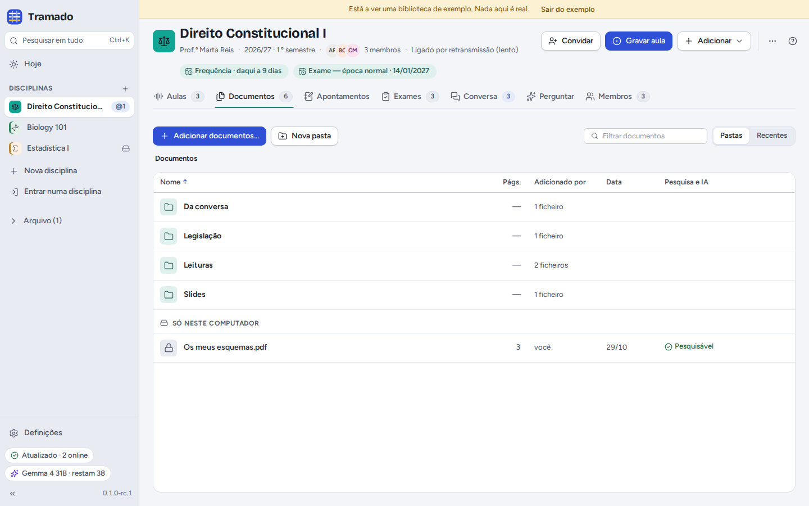
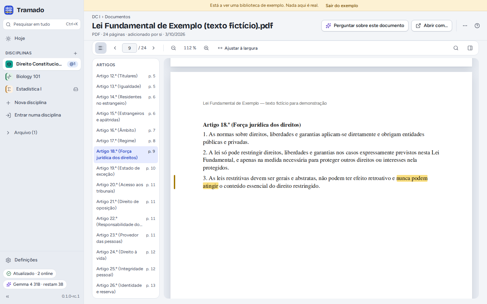
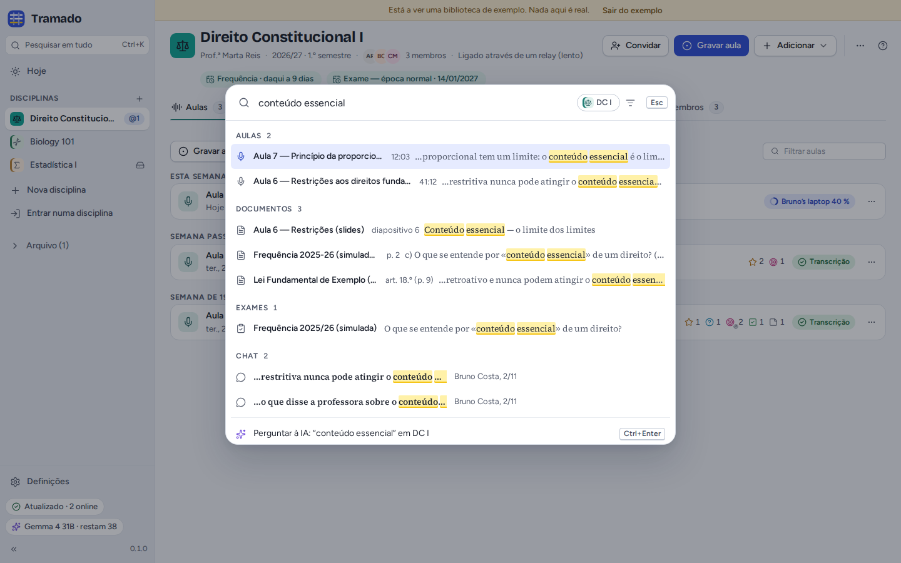

# 4. Documentos, apontamentos e pesquisa

[Índice](index.md) · Anterior: [Aulas](03-lectures.md) · Seguinte: [Exames](05-exams.md)

## Adicionar documentos

Arraste ficheiros para a janela, ou use **Adicionar documentos…**: PDF, Word (`.docx`), PowerPoint (`.pptx`), texto
OpenDocument, RTF, HTML, Markdown, texto simples, legendas e imagens. O Tramado copia-os para a pasta da disciplina e lê
o texto, para que a pesquisa e a IA o possam usar. A coluna do texto mostra até onde chegou:

- **Pesquisável**: pronto;
- **A ler o texto… 40 %**: ainda a trabalhar (os códigos legais grandes demoram um pouco);
- **Digitalização — sem texto**: o ficheiro é uma imagem das páginas. Com a IA configurada, **Ler o texto com IA…** (no
  menu do ficheiro) lê até 20 páginas, com um pedido à IA por página.

O Tramado repara quando um colega já adicionou o mesmo ficheiro, e propõe organizar os ficheiros da disciplina em
pastas (*Diapositivos*, *Leituras*, *Legislação*, *Exames anteriores*). Numa disciplina partilhada, o menu de um
ficheiro tem **Manter privado (só para si)…** (passa para *Só neste computador*), **Remover só deste computador…** e
**Eliminar para todos…** (pode ser reposto durante 30 dias em *Eliminados recentemente*).

## Ler um documento

Os PDF abrem dentro do Tramado, com navegação por **página**, **zoom**, **Ajustar à largura** e **Procurar no
documento**. Os textos legais têm a lista dos **Artigos** à esquerda. Selecione texto para o **Destacar** (os
destaques ficam neste computador), **Explicar**, **Perguntar** sobre ele ou **Copiar com a fonte** (*"…" —
Constituição, art. 18.º, p. 9*). **Perguntar sobre este documento** abre o Perguntar com este documento como fonte;
**Abrir com…** abre o ficheiro noutra aplicação. Quando uma resposta da IA cita um excerto, o documento abre nessa
página com o excerto marcado.

## Apontamentos

O separador **Apontamentos** tem dois tipos, ambos ficheiros Markdown:

- **Os meus apontamentos · só para si**: apenas neste computador;
- **Apontamentos da turma · partilhados com todos**: na pasta da disciplina, todos os podem ler e editar.

A barra de ferramentas tem negrito, itálico, títulos, listas, listas de verificação e ligações, e ainda **ligações a um
momento de uma aula** ou **a uma página de um documento**, que abrem logo ali. O menu de uns apontamentos passa-os de um
tipo para o outro. Se duas pessoas editarem os mesmos apontamentos da turma ao mesmo tempo, as duas versões são
guardadas e **Comparar** mostra-as lado a lado.

## Pesquisar em tudo

<kbd>Ctrl</kbd>+<kbd>K</kbd> (<kbd>⌘</kbd>+<kbd>K</kbd>), ou **Pesquisar em tudo** na barra lateral, pesquisa na
disciplina em que está, ou em todas, de uma só vez: transcrições das aulas (com o minuto), documentos (com a página ou o
artigo), apontamentos, perguntas de exames e mensagens da conversa. <kbd>Enter</kbd> abre um resultado no sítio onde
foi encontrado. A última linha, **Perguntar à IA** (<kbd>Ctrl</kbd>+<kbd>Enter</kbd>), faz a mesma pergunta à IA sobre
as suas fontes. A pesquisa também executa comandos: escreva o que quer fazer (por exemplo *definições*) ou o nome de
uma disciplina.

A pesquisa funciona sem IA e sem internet. Acentos e maiúsculas não contam.
