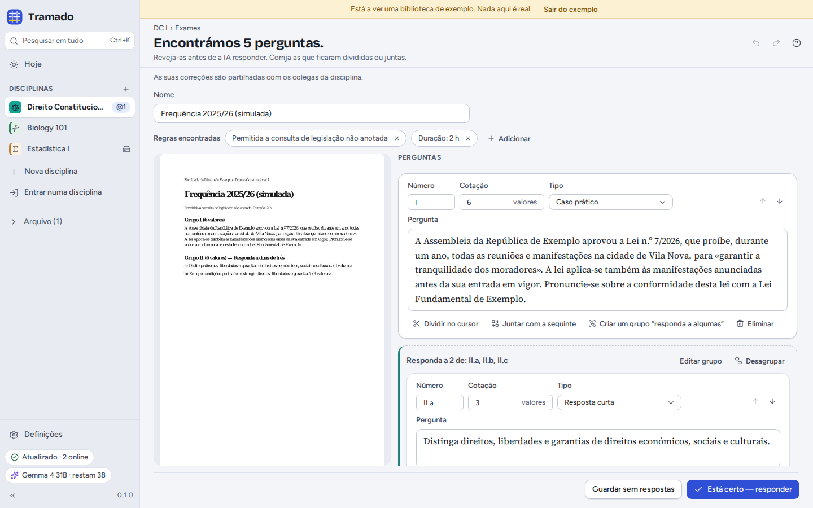
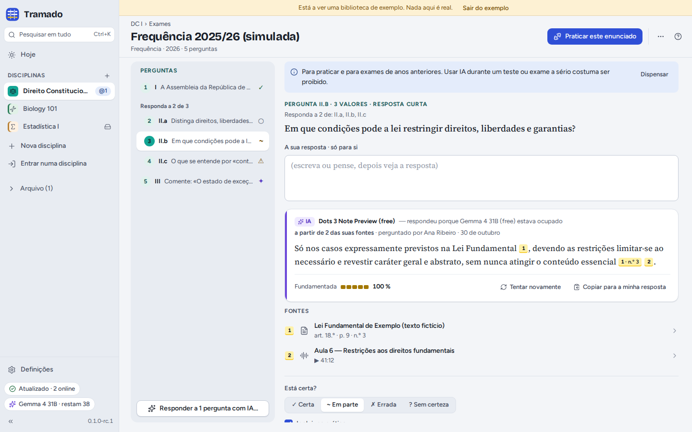
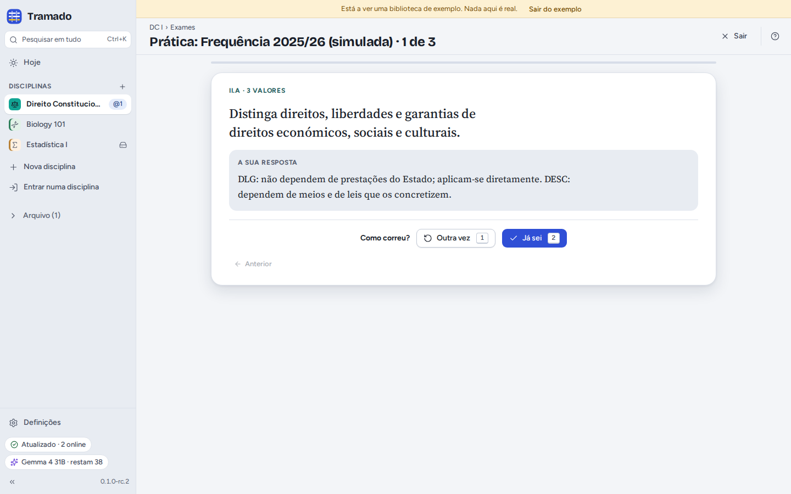

# 5. Exames

[Índice](index.md) · Anterior: [Documentos, apontamentos e pesquisa](04-documents-notes-search.md) · Seguinte: [Turmas](06-class-groups.md)

O separador **Exames** guarda as datas dos testes e exames, e os enunciados de anos anteriores ou perguntas de treino
para praticar.

## Datas de exames

**Adicionar › Um teste ou exame que aí vem**: o tipo (mini-teste, teste, frequência, exame final, exame de recurso,
época especial…), o nome, a data e a hora (deixe a hora vazia para um dia inteiro), a sala, a matéria e o peso na nota.
O Tramado faz a contagem decrescente em **Hoje** e no cabeçalho da disciplina. Numa disciplina partilhada, todos veem a
data.

## Enunciados

**Adicionar › Um enunciado ou perguntas de treino**: arraste um PDF, um ficheiro Word ou fotografias do enunciado, ou
**Escrever ou colar as perguntas**. **Encontrar as perguntas** usa a IA: antes de começar, o Tramado diz quantos
pedidos vai gastar (um por página a ler, mais um para encontrar as perguntas) e quantos pedidos gratuitos lhe restam
hoje. Sem IA, escreva as perguntas você mesmo. Pode sair do ecrã enquanto lê; o Tramado continua.

### Verificar as perguntas

Antes de qualquer resposta, verifique o que foi encontrado, ao lado do original: o **número**, os **pontos**, o
**tipo** e o **texto** de cada pergunta. Corrija perguntas divididas ou juntas por engano (**Dividir no cursor**,
**Juntar com a seguinte**), agrupe as perguntas do tipo "responda a duas de três" (**Criar um grupo "responda a
algumas"**) e mantenha ou retire as **regras encontradas** (por exemplo *consulta de legislação não anotada*,
*duração: 2 h*). Depois, **Está certo — responder**, ou **Guardar sem respostas**. Numa disciplina partilhada, as suas
correções são partilhadas.

### Respostas com fontes

Escolha como a IA responde (só com os materiais da disciplina, ou também com conhecimento geral, marcado como não
verificado) e se quer **tentar responder primeiro a cada pergunta** (recomendado: responder antes de ver é o que faz
fixar). Depois, em cada pergunta:

- escreva a resposta em **A sua resposta · só você**, ou pense nela;
- **Mostrar a resposta da IA**. Cada afirmação tem uma **citação** numerada: passe o rato por cima para ver a passagem,
  clique para abrir a página do documento, o artigo ou o momento da aula. **Fundamentada** mostra quanto da resposta
  está apoiado nas suas fontes; as frases que não estão nos seus materiais ficam assinaladas;
- marque-a como **Certa**, **Em parte**, **Errada** ou **Sem certeza**, acrescente a resposta certa se a souber e
  **Incluir no treino**.

O cartão da IA diz que modelo respondeu, e quando o modelo gratuito predefinido estava ocupado e outro respondeu em vez
dele. Numa disciplina partilhada, as respostas da IA são partilhadas, para os colegas não gastarem os seus pedidos nas
mesmas perguntas.

> Para treino e exames de anos anteriores. Usar IA durante um teste ou exame a sério costuma ser proibido.

## Treino

**Treinar este enunciado**, ou **Praticar** em Hoje, mostra uma pergunta de cada vez. Pense ou escreva a resposta,
<kbd>Espaço</kbd> mostra a resposta e depois diga como correu: **Outra vez** (<kbd>1</kbd>) ou **Já sei**
(<kbd>2</kbd>). As perguntas em que falhou voltam no dia seguinte. O seu treino fica no seu computador.
