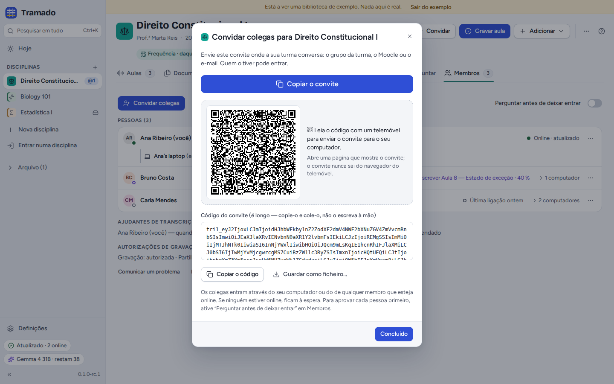
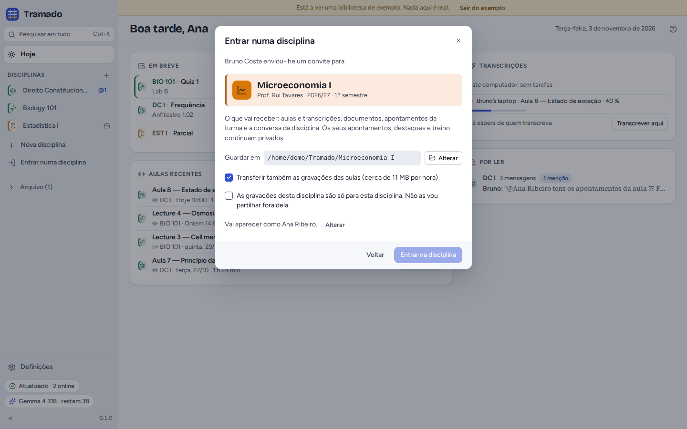
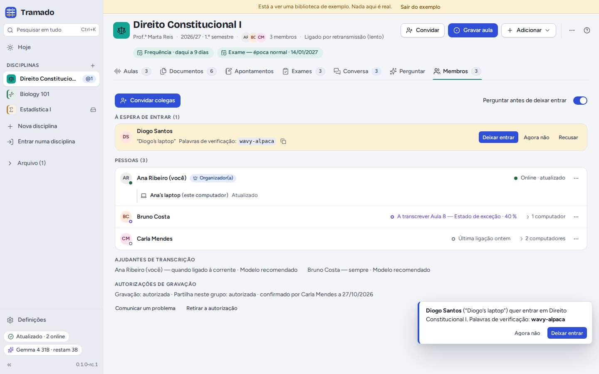
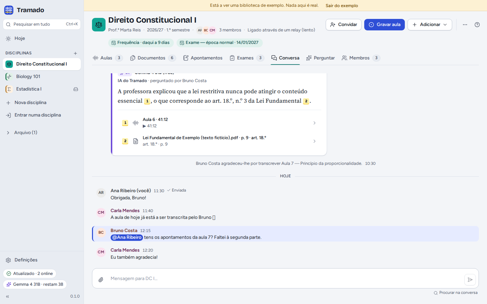
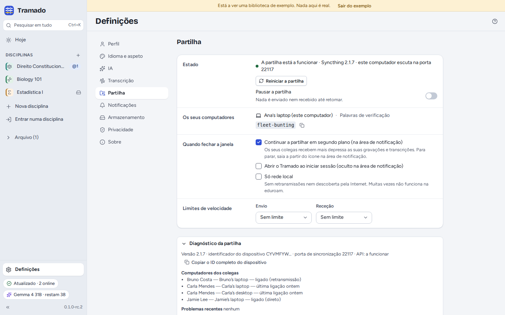

# 6. Turmas

[Índice](index.md) · Anterior: [Exames](05-exams.md) · Seguinte: [IA](07-ai.md)

Partilhe uma disciplina e os colegas recebem a mesma pasta: aulas e transcrições, documentos, apontamentos da turma,
enunciados e respostas da IA partilhadas, e uma conversa da turma. Os seus apontamentos, destaques, treino e conversas
do Perguntar nunca fazem parte dela.

Não há servidor do Tramado. A partilha usa o [Syncthing](https://syncthing.net), que vem dentro do Tramado: os
ficheiros viajam cifrados, diretamente entre os computadores dos colegas, sempre que dois deles estejam ligados ao
mesmo tempo. Para se encontrarem em redes diferentes, os computadores usam os servidores públicos de descoberta e de
retransmissão do Syncthing; ver [Definições e privacidade](08-settings-and-privacy.md).

## Partilhar uma disciplina

Ligue **Partilhar com os colegas** ao criar uma disciplina, ou mais tarde use o separador **Partilhar** da disciplina
(ou **⋯ › Partilhar esta disciplina…**). Da primeira vez, o Tramado pergunta se quer **continuar a partilhar em
segundo plano** quando fecha a janela: assim os colegas recebem mais depressa as suas gravações e transcrições. Pode
mudar isto em Definições › Partilha.

## Convidar colegas

**Convidar** (no cabeçalho da disciplina ou em Membros) mostra o convite:

- **Copiar o convite** copia uma mensagem curta com uma ligação e o código: cole-a no grupo da turma, no Moodle ou
  num e-mail. A ligação abre no navegador a página de entrada do Tramado (`https://feiteira.github.io/Tramado/join/`);
- o **código QR** abre a mesma página no telemóvel que o ler;
- **Copiar o código** copia só o código, e **Guardar como ficheiro…** guarda um ficheiro `.tramado-invite`, que se abre
  em **Entrar numa disciplina › Abrir um ficheiro de convite…**.

A página de entrada mostra a disciplina e quem enviou o convite. Num computador com o Tramado, **Abrir no Tramado** abre
o convite em **Entrar numa disciplina**; num telemóvel, carregue em **Copiar o código**, envie o código para o seu
computador (por e-mail, ou por uma aplicação de mensagens que também use no computador) e cole-o em **Entrar numa
disciplina**. O convite fica na parte da ligação depois do `#`, que o navegador nunca envia a um servidor: a página
lê-o no seu dispositivo e não envia nada para lado nenhum.

Quem tiver o convite pode entrar, através do seu computador ou do de qualquer membro que esteja ligado; se não
houver ninguém ligado, fica à espera. Para autorizar cada pessoa primeiro, um organizador liga **Perguntar antes de
deixar entrar**, em Membros.

## Entrar numa disciplina

**Entrar numa disciplina** (na barra lateral, ou <kbd>Ctrl</kbd>+<kbd>Shift</kbd>+<kbd>J</kbd>): cole o convite (a
mensagem inteira serve) ou abra um ficheiro de convite, e carregue em **Continuar**. (Uma ligação abre primeiro a
página de entrada: aí, **Abrir no Tramado** abre esta janela já com o convite.) O Tramado mostra a disciplina e quem o
convidou. Escolha onde a guardar, se quer **transferir também as gravações das aulas** (cerca de 11 MB por hora;
recebe sempre todas as transcrições) e aceite que as gravações desta disciplina são só para ela. Depois, **Entrar na
disciplina**.

O Tramado mostra as suas **palavras de verificação** (por exemplo *wavy-alpaca*). Se a disciplina pergunta antes de
deixar entrar, um membro vê as mesmas palavras junto ao seu nome: diga-as em voz alta ou no grupo da turma, para que
saibam que é mesmo você. Pode fechar a janela enquanto espera; o Tramado avisa quando entrar, e os ficheiros começam a
chegar.

## Membros

O separador **Membros** mostra:

- **À espera de entrar** (quando a disciplina pergunta primeiro): **Deixar entrar**, **Agora não** ou **Recusar**.
  Compare primeiro as palavras de verificação.
- **Pessoas**, com quem está ligado, o que está a fazer (por exemplo a transcrever uma aula) e os seus computadores.
  Os organizadores podem **Tornar organizador(a)** e **Remover da disciplina…**: o Tramado de todos deixa de partilhar a
  disciplina com os computadores dessa pessoa (ela fica com o que já tem), e a partir daí quem chegar tem de ser
  autorizado.
- **Ajudantes de transcrição**: quem transcreve automaticamente as aulas da disciplina, e com que modelo.
- **Autorizações de gravação**: a autorização do docente registada, quem a confirmou e quando; **Retirar a
  autorização** impede que as novas gravações sejam partilhadas.

Se a disciplina ficar sem organizadores (saíram todos), qualquer membro pode carregar em **Tornar-me organizador(a)**.

## A conversa da turma

Escreva à turma em **Conversa**. Responda a uma mensagem, mencione alguém com **@**, ou pergunte à **@IA**: o Tramado
responde a partir das aulas e documentos da disciplina, com a sua chave de IA, citando as fontes, e todos veem a
resposta (as chaves dos colegas nunca são partilhadas). Os ficheiros que anexar ficam também em **Documentos › Da conversa**. Uma mensagem mostra **✓ Enviada** quando pelo menos o computador de um colega a recebeu; até lá, fica guardada à
espera.

## Sincronização e problemas

O indicador da **partilha**, no fundo da barra lateral, diz como corre a partilha: *Atualizado · 2 online*, *A
sincronizar 3 ficheiros*, *À espera dos colegas* (ninguém está ligado: as alterações ficam guardadas e sincronizam mais
tarde), *Partilha em pausa* ou *A partilha não está a funcionar*. Clique nele para ver os detalhes. Na eduroam e
noutras redes de universidades, os computadores muitas vezes não conseguem ligar-se diretamente; passam então por uma
retransmissão, que é mais lenta (o cabeçalho da disciplina indica-o).

Quando duas pessoas alteram o mesmo ficheiro ao mesmo tempo, as duas versões são guardadas (a outra fica marcada como
*Cópia em conflito*). Em **⋯ › Eliminados recentemente…** de uma disciplina, os ficheiros eliminados podem ser repostos
durante 30 dias.

## Definições › Partilha

- **Estado**: se a partilha está a funcionar, com **Reiniciar a partilha** e **Pausar a partilha**.
- **Os seus computadores**: este computador e as suas palavras de verificação. (Juntar um segundo computador seu está
  previsto para uma versão posterior.)
- **Quando fechar a janela**: continuar a partilhar em segundo plano (na área de notificação) e abrir o Tramado quando
  inicia sessão.
- **Só rede local**: sem retransmissões nem descoberta pela internet (muitas vezes não funciona na eduroam).
- **Limites de velocidade** de envio e de receção.
- **Diagnóstico da partilha**: versão, portas, os computadores dos colegas e como se ligam, problemas recentes e o
  registo, para copiar para uma comunicação de erro.
