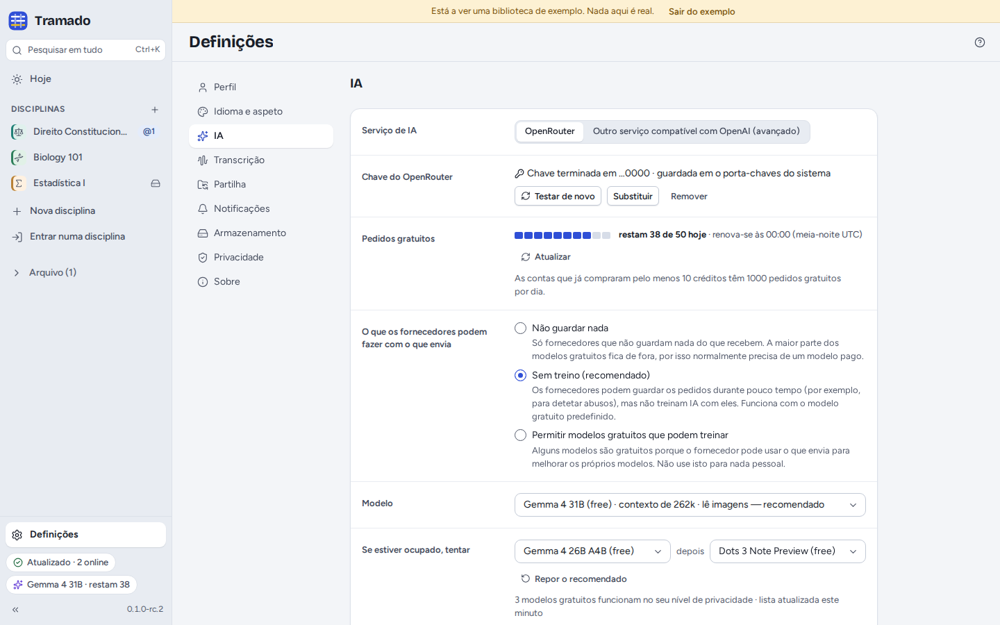
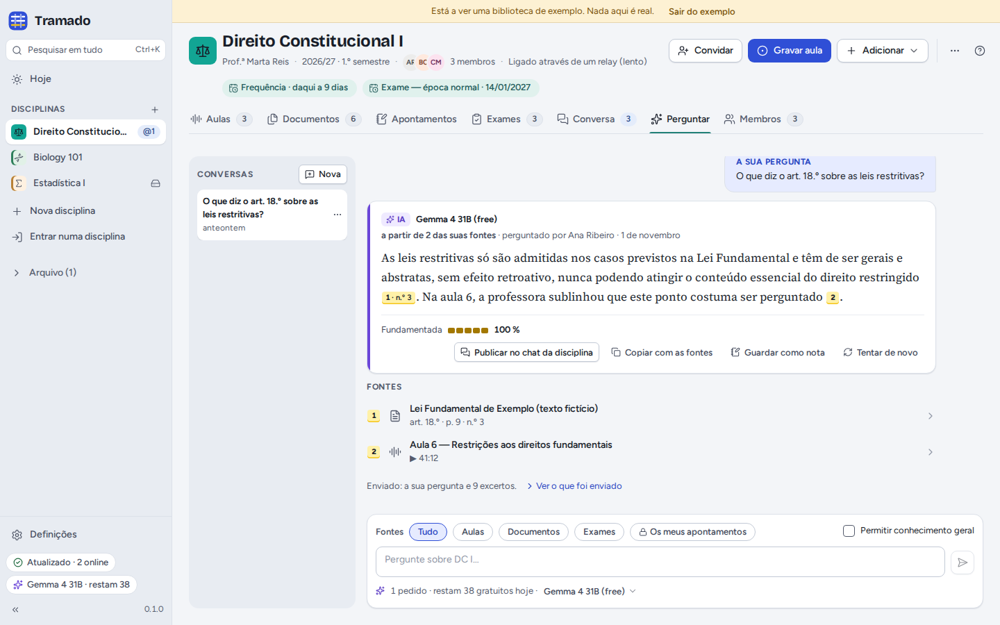

# 7. IA

[Índice](index.md) · Anterior: [Turmas](06-class-groups.md) · Seguinte: [Definições e privacidade](08-settings-and-privacy.md)

A IA é opcional. Sem ela continua a poder gravar, transcrever, pesquisar, tomar apontamentos, partilhar e treinar; os
botões de IA ficam simplesmente escondidos. Com ela, o Tramado responde a perguntas de exame, explica passagens, resume
aulas, lê páginas digitalizadas e responde a perguntas sobre as suas disciplinas, sempre **a partir dos materiais da
disciplina, com citações**.

## Configurar

O Tramado usa o [OpenRouter](https://openrouter.ai), um serviço que dá acesso a muitos modelos de IA com uma só chave.
Usa **a sua própria chave**, e os modelos gratuitos funcionam:

1. Crie uma chave gratuita em [openrouter.ai/keys](https://openrouter.ai/keys).
2. Cole-a em Definições › IA (ou no passo do primeiro arranque) e carregue em **Testar e guardar**.

> O OpenRouter é para maiores de **18 anos**. Se for mais novo, não o use: salte a IA, ou ligue outro serviço (ver
> [mais abaixo](#outro-serviço-ia-local)).

A chave fica guardada no porta-chaves do sistema (ou, se não houver, num ficheiro privado que só você pode ler) e nunca
chega à janela da aplicação: é o próprio Tramado que a junta a cada pedido.

### Pedidos gratuitos

Os modelos gratuitos não custam nada, mas têm limites: 50 pedidos por dia nas contas que nunca compraram crédito, 1000
por dia depois de comprar pelo menos 10 créditos, e cerca de 20 por minuto. Definições › IA e o indicador da IA
mostram quantos restam hoje (a contagem recomeça à meia-noite UTC). Antes de algo que gaste vários pedidos (ler um
exame digitalizado, responder a um enunciado inteiro), o Tramado diz quantos vai usar.

### O modelo

O modelo predefinido é o **Gemma 4 31B (free)** (`google/gemma-4-31b-it:free`). **Se estiver ocupado, tentar** indica
outros dois modelos gratuitos que o Tramado experimenta a seguir; **Repor o recomendado** volta a eles. Cada resposta
diz que modelo a escreveu.

Os modelos gratuitos estão muitas vezes ocupados. Quando estão todos, o Tramado avisa e propõe tentar de novo, **Usar
os modelos gratuitos da NVIDIA neste pedido** ou **Mudar de modelo**. Os modelos gratuitos da NVIDIA podem usar o que
envia para treinar a IA deles, por isso o Tramado nunca passa para eles sem perguntar, a não ser que escolha **Usá-los
sempre que estiverem ocupados**.

### O que os fornecedores podem fazer com o que envia

| Nível | Significado |
|---|---|
| **Não guardar nada** | Só fornecedores que não guardam nada do que recebem. A maioria dos modelos gratuitos fica de fora: normalmente vai precisar de um modelo pago. |
| **Sem treino (recomendado)** | Os fornecedores podem guardar os pedidos durante pouco tempo (por exemplo, para detetar abusos), mas não treinam IA com eles. Funciona com o modelo gratuito predefinido. |
| **Permitir modelos gratuitos que podem treinar** | Alguns modelos gratuitos são gratuitos porque o fornecedor pode usar o que envia para melhorar a IA. Não use esta opção para nada pessoal. |

Tornar o nível menos rigoroso pede sempre a sua confirmação numa janela à parte.

## O que a IA recebe

Só o que cada pergunta precisa: a sua pergunta e as **passagens** das suas fontes que lhe respondem (com os nomes dos
ficheiros e as páginas ou os tempos). Nunca uma pasta inteira, nunca os seus apontamentos privados a não ser que inclua
*Os meus apontamentos*, nunca o histórico da conversa nem outras disciplinas. Por baixo de cada resposta, **Ver o que
foi enviado** mostra exatamente o que saiu. Definições › Privacidade guarda um registo de todos os pedidos feitos
deste computador.

## Perguntar

O separador **Perguntar** de uma disciplina (ou **Perguntar à IA** em todas as disciplinas, a partir da pesquisa) é uma
conversa sobre os seus materiais. Escolha as **Fontes** (todas, aulas, documentos, exames, ou *Os meus apontamentos*) e
se quer **Permitir conhecimento geral** (as frases que não estão nos seus materiais ficam então marcadas como não
verificadas). As respostas têm citações e uma percentagem **Fundamentada**. A partir de uma resposta pode **Publicar no
chat da disciplina**, **Copiar com as fontes**, **Guardar como nota** ou tentar de novo. As conversas ficam neste
computador.

A IA também está noutros sítios: **Explicar** no texto selecionado, o separador **IA** de uma aula, **Perguntar à IA**
na pesquisa, **@IA** na conversa e as respostas a exames ([Exames](05-exams.md)).

## Outro serviço (IA local)

**Definições › IA › Outro serviço compatível com OpenAI (avançado)** liga qualquer serviço que fale a API da OpenAI:
o [Ollama](https://ollama.com) ou o [LM Studio](https://lmstudio.ai) no seu computador, ou um servidor da sua
faculdade. Indique o **Endereço**, uma **Chave** se for precisa e o **Modelo**, e carregue em **Testar**. O `http`
simples só funciona para o seu computador e a sua rede local; o Tramado pede-lhe que confirme cada endereço novo numa
janela à parte. O que o serviço faz com os seus dados depende de quem o gere.

## Desligar a IA

**Desligar a IA neste computador** (Definições › IA) esconde todos os botões de IA; a chave continua guardada.
