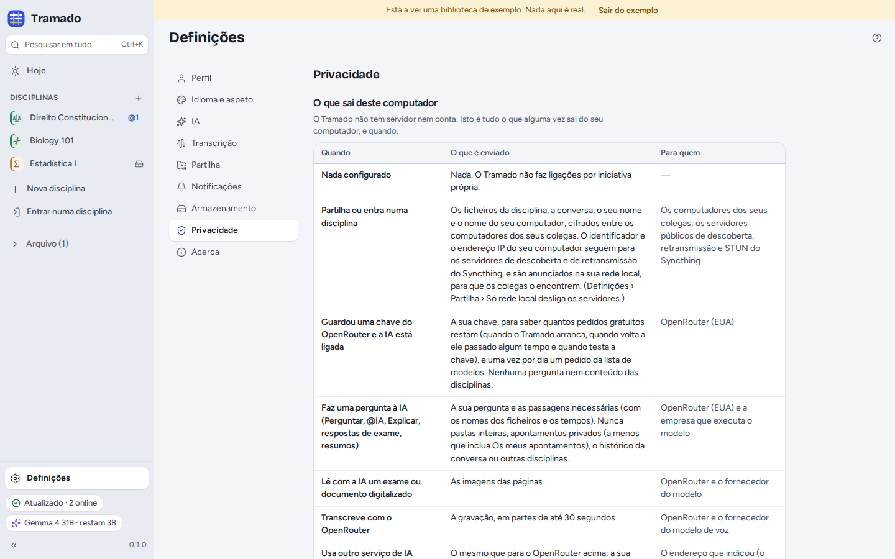

# 8. Definições e privacidade

[Índice](index.md) · Anterior: [IA](07-ai.md)

As **Definições** estão no fundo da barra lateral (<kbd>Ctrl</kbd>+<kbd>,</kbd>).

## As secções

- **Perfil**: o seu nome (os colegas veem-no em todas as disciplinas que partilha), o nome deste computador e a sua
  cor. Os colegas veem o seu nome e os nomes dos seus computadores, nunca um número de telefone nem um e-mail.
- **Idioma e aspeto**: English, Português (Portugal) ou Español (España); tema claro, escuro ou o do sistema; tamanho
  do texto; o tipo de letra (o predefinido, *Atkinson Hyperlegible Next*, mais fácil de ler, ou *OpenDyslexic*);
  reduzir o movimento.
- **IA**: a chave, o nível de privacidade, o modelo e as alternativas, a língua das respostas, outro serviço e desligar
  a IA. Ver [IA](07-ai.md).
- **Transcrição**: modelos de voz, ajudar a turma a transcrever, transcrição na nuvem, o microfone e o seu teste, a
  qualidade da gravação (*Normal*, cerca de 11 MB por hora, ou *Poupar espaço*, cerca de 7 MB por hora), quanto recuam
  os marcadores e os atalhos dos marcadores que funcionam a partir de qualquer aplicação. Ver
  [Aulas](03-lectures.md#transcrição).
- **Partilha**: ver [Turmas](06-class-groups.md#definições--partilha).
- **Notificações**: notificações do sistema, e sobre o que quer ser avisado (uma transcrição de que está à espera,
  alguém a entrar, uma data de exame acrescentada ou alterada, um modelo de voz transferido). Cada disciplina pode
  mudar isto no menu **⋯ › Notificações**.
- **Armazenamento**: onde são criadas as novas disciplinas; o tamanho de cada disciplina (gravações, e ficheiros
  eliminados guardados durante 30 dias) com **Esvaziar o lixo** e **Sem áudio**; os modelos de voz; a
  cache (texto para pesquisa, índices), que se reconstrói sozinha; e se quer remover as gravações que fez depois de
  transcritas (nunca, ao fim de 30 ou de 90 dias; a transcrição fica).
- **Privacidade**: ver abaixo.
- **Sobre**: a versão, a licença e o código-fonte; **Atalhos de teclado**; **Copiar diagnóstico** (nada é enviado);
  **Testar a reprodução de áudio**; as licenças do software que o Tramado inclui.

## O que sai do seu computador

O Tramado não tem servidor nem conta. Definições › Privacidade enumera tudo o que alguma vez sai do seu computador, e
quando. A mesma tabela está no repositório em [PRIVACY.pt.md](../../../PRIVACY.pt.md) ([English](../../../PRIVACY.md)
· [Español](../../../PRIVACY.es.md)). Em resumo:

- **Nada**, até partilhar uma disciplina, ligar a IA ou transferir um modelo de voz. Sem telemetria, sem estatísticas
  de utilização, sem relatórios de erros; as estatísticas de utilização do Syncthing estão desligadas.
- **Partilhar uma disciplina** envia os ficheiros da disciplina, a conversa, o seu nome e o nome do seu computador,
  cifrados, para os computadores dos colegas. O identificador e o endereço IP do seu computador vão para os servidores
  de descoberta e de retransmissão do Syncthing e são anunciados na rede local, para que os colegas o encontrem (*Só
  rede local* desliga os servidores).
- **A IA** envia a sua pergunta e os excertos de que precisa para o OpenRouter e para a empresa que gere o modelo (ou
  para o serviço que configurou). Com uma chave guardada e a IA ligada, o Tramado também verifica quantos pedidos
  gratuitos restam e, uma vez por dia, obtém a lista de modelos.
- **Transcrever com o OpenRouter** envia a gravação em pedaços de até 30 segundos; **ler uma digitalização com IA**
  envia as imagens das páginas.
- **Transferir um modelo de voz** envia um pedido de transferência ao Hugging Face.
- **Abrir a ligação de um convite** num navegador (ou ler o código QR de um convite) carrega a página de entrada do
  Tramado a partir do GitHub Pages, que vê o seu endereço IP e o seu navegador, como em qualquer página web. O código do
  convite fica na parte da ligação depois do `#`, que o navegador nunca envia.

A **Atividade da IA neste computador** é um registo privado de todos os pedidos à IA feitos daqui (hora, disciplina,
ação, modelo, excertos enviados). Nunca é enviado para lado nenhum; **Limpar o registo** esvazia-o.

## Onde estão os seus ficheiros

- **As suas disciplinas** são pastas normais, por predefinição em `Tramado`, na sua pasta pessoal (Definições ›
  Armazenamento muda onde são criadas as novas).
- **Os dados privados do Tramado** (os seus apontamentos, destaques, treino, conversas do Perguntar e o registo de
  atividade da IA), os modelos de voz e a cache ficam nas pastas do próprio Tramado, neste computador, e nunca são
  partilhados. No Linux são `~/.local/share/eu.thehumanloop.tramado`, `~/.config/eu.thehumanloop.tramado` e
  `~/.cache/eu.thehumanloop.tramado`. Definições › Privacidade › *Onde estão os seus dados* abre cada uma delas.
- **A sua chave do OpenRouter** fica no porta-chaves do sistema, ou num ficheiro privado na pasta de definições do
  Tramado quando não há porta-chaves.
